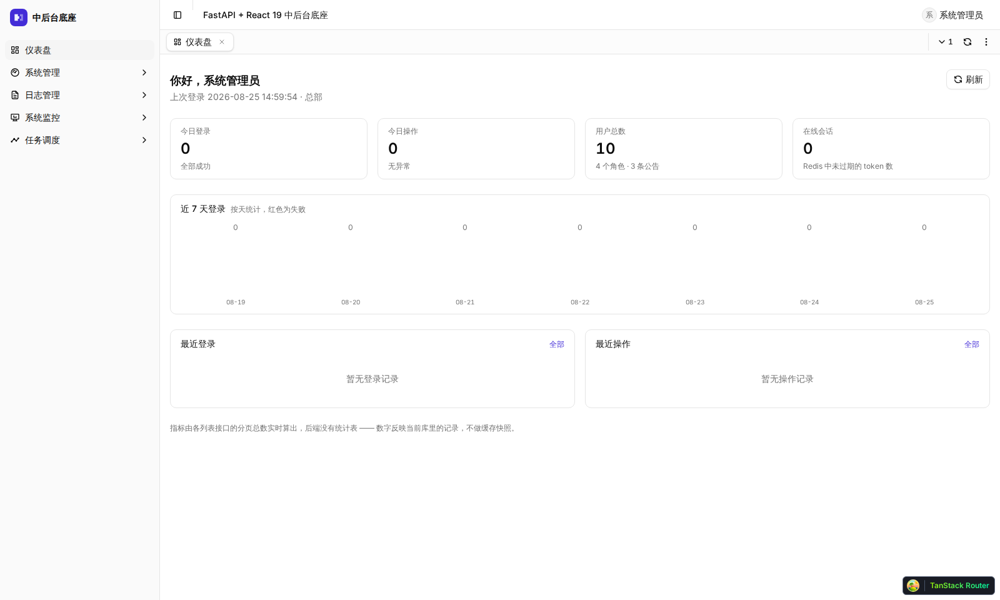
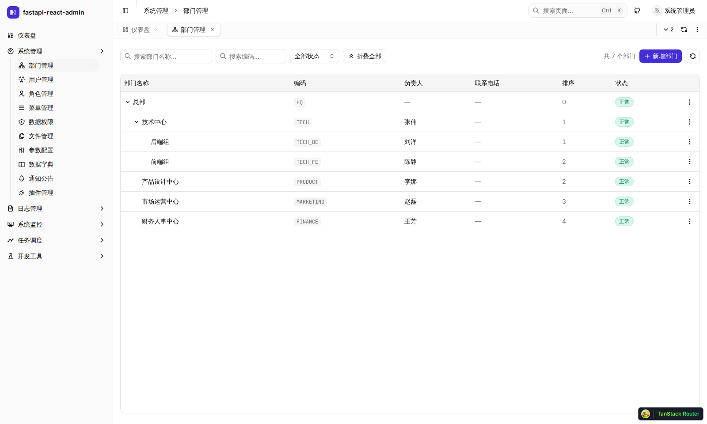
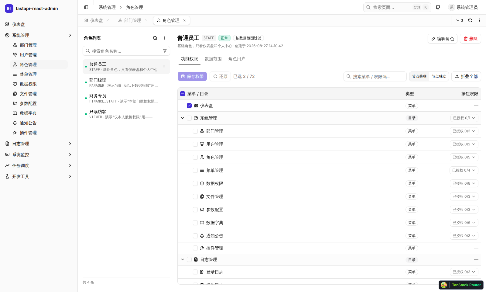
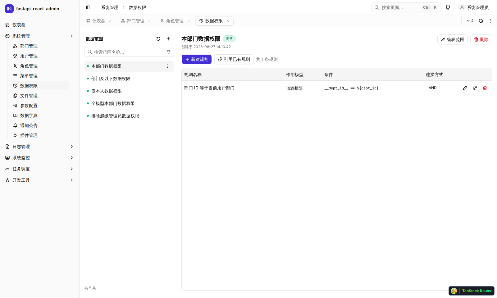
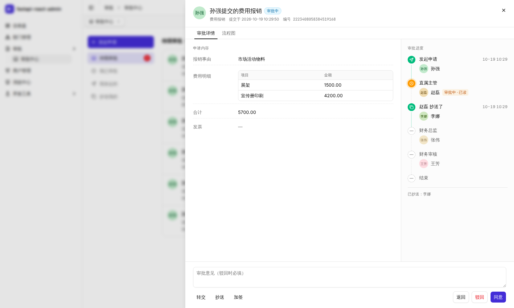
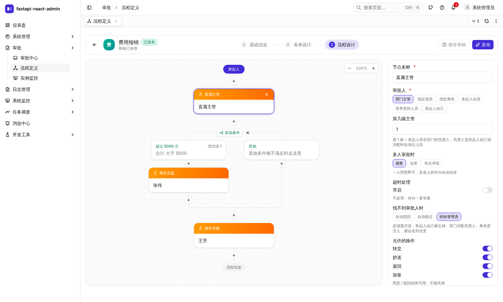

# fastapi-react-admin

**FastAPI + React 19 + shadcn/ui 中后台底座** —— 权限细到按钮和数据行，多页签切走真的保状态，
PostgreSQL / SQL Server / MySQL 三种库都能跑。自带飞书式审批流、受权限约束的 AI 助手、
对外开放接口、本地 + S3 存储与大文件断点续传，另有桌面端和原生移动端。
**后端 767 条 + 前端 89 条端到端测试，打真实数据库和真实浏览器，不 mock。**

> 🚀 **在线演示 / Live demo：** https://fra.wubunan.com/sign-in
> 账号 `admin` / 密码 `123456` —— 公开演示实例，任何人都能登录，数据会被访客改动/清空，
> 请勿存放真实信息。/ Public demo instance, anyone can log in; data may be altered or wiped
> by other visitors — do not store real information here.

<table>
<tr>
<td width="50%"></td>
<td width="50%"></td>
</tr>
<tr>
<td width="50%"></td>
<td width="50%"></td>
</tr>
<tr>
<td width="50%"></td>
<td width="50%"></td>
</tr>
</table>

<!-- 前端 -->
[](https://react.dev)
[](https://www.typescriptlang.org)
[](https://vite.dev)
[](https://tailwindcss.com)
[](https://ui.shadcn.com)
[](https://tanstack.com)

<!-- 后端与数据 -->
[](https://fastapi.tiangolo.com)
[](https://www.sqlalchemy.org)
[](https://www.postgresql.org)
[](https://learn.microsoft.com/sql)
[](https://redis.io)
[](https://docs.celeryq.dev)
[](https://www.electronjs.org)
[](https://expo.dev)

<!-- 状态 -->
[](https://github.com/yilecoding/fastapi-react-admin/releases)
[](./LICENSE)
[](https://github.com/yilecoding/fastapi-react-admin/actions/workflows/ci.yml)
[](https://yilecoding.github.io/fastapi-react-admin/)

[中文](#为什么不是又一个模板) · **[English](#english)**

---

<a id="english"></a>

## English

An admin foundation on **FastAPI + React 19 + shadcn/ui** — permissions down to buttons
*and data rows*, multi-tab navigation that actually keeps state, and it runs on
**PostgreSQL, SQL Server or MySQL**. It ships a Feishu-style **approval workflow**, an
**AI assistant** that can only do what the signed-in user could do, a signed **open API**
for external systems, **local + S3-compatible storage** with resumable large-file uploads,
plus an Electron desktop shell and a native Expo / React Native mobile app.
**767 backend tests and 89 browser end-to-end tests run against real databases and a real
browser — no mocks.**

Not a scaffold you fork and ship — a *foundation*. The parts below, plus the hard-won rules
in [CLAUDE.md](./CLAUDE.md), are already solved; business code goes next to
`packages/platform/src/pages/user/` and follows the same shape.

|                       | Common approach                                                            | Here                                                                                            |
| --------------------- | -------------------------------------------------------------------------- | ----------------------------------------------------------------------------------------------- |
| **Permission grain**  | menus + buttons                                                            | menus + buttons + **data scopes** — a role decides which *rows* it sees, via rules bound to model columns |
| **Multi-tab**         | free in Vue via `keep-alive`; usually absent in React, or loses state       | React 19 **`<Activity>`** — every open tab stays mounted; hidden ones drop effects but keep DOM and state |
| **Component base**    | most templates still on the pre-migration shadcn/Radix combo               | already on shadcn's current default, **Base UI** — zero `@radix-ui` imports, plus an in-app sandbox with copy-paste code for every component |
| **Database**          | one of MySQL / PostgreSQL                                                  | **PostgreSQL (default), SQL Server and MySQL** — SQL Server is first-class (`aioodbc`, NVARCHAR, filtered unique indexes, `OFFSET FETCH`), and CI runs the full backend suite on both PostgreSQL and SQL Server |
| **Tests**             | templates usually ship none; when present, component unit tests over jsdom + mocked fetch | **767 pytest against a real database and Redis + 89 Playwright against a real browser, API and database.** The row-level permission model is verified with real accounts (22 via the API, 19 via the browser) |

**What's inside**

- **Access control** — RBAC (menus · buttons · data scopes), row-level data permissions
  enforced in the CRUD base class, organisation tree, users and roles
- **Shell** — multi-tab workspace that keeps state, command palette (⌘K), shortcut help,
  guided tour, per-user time zone, theme / radius / tab style preferences, zh-CN / en-US
- **Files & storage** — file manager with previews (pdf / docx / xlsx / images / text /
  archives), local + S3-compatible storages with pre-signed downloads, recycle bin,
  chunked & resumable uploads with a Google-Drive-style upload tray, instant upload by sha256
- **Approval workflow** — form designer + flow tree; approve / reject / transfer / send back /
  take back / add approvers / timeouts; versioned state changes
- **AI assistant** — chat page and side drawer; tools go through one dispatcher that applies
  RBAC, data scopes, preview → confirm for writes, and an audit log; an MCP gateway lets
  external systems call the same tools under per-credential rate limits
- **Open API** — AK/SK HMAC-signed read-only endpoints with scopes, IP allow-lists, replay
  protection, rate limits, call logs, cursor-based incremental sync, and reference SDKs
  (Python / Node / Java)
- **Operations** — notification inbox (socket push), scheduled tasks (Celery beat, cron
  preview, run history), bulk user import from xlsx, notices with rich text, config & dicts,
  login / operation logs with redaction, online sessions, server & Redis monitoring, OAuth2 login
- **Clients** — Electron desktop shell (silent printing, local hardware bridge, credential
  storage, auto-update; installers for Windows / macOS / Linux on every release) and a native
  Expo app (not a WebView)

**Status:** latest release **[v0.1.0](https://github.com/yilecoding/fastapi-react-admin/releases)**.
Still 0.x — schema changes go through Alembic migrations. See [SECURITY.md](./SECURITY.md)
for security caveats to handle before deploying.

### Stack

**Frontend** — React 19.2 · TypeScript 6 · Vite 8 · TanStack Router v1 / Query v5 /
**Table v9** / Virtual v3 · Tailwind CSS 4 (CSS-first `@theme`) · shadcn 4 on
**Base UI** (not Radix — zero `@radix-ui` imports) · zustand 5 · react-hook-form 7 + zod 4 ·
Tiptap 3 · `@file-viewer` 2.3 · `hash-wasm` · driver.js · i18next 26 · `openapi-fetch` +
`openapi-typescript` 7 · socket.io-client 4

**Backend** — FastAPI · Pydantic 2 · SQLAlchemy 2 (asyncio) + Alembic · asyncpg / aioodbc /
asyncmy · Redis 8 · Celery 5 · python-socketio · Apache OpenDAL (local + S3) ·
pydantic-ai + MCP · pwdlib/bcrypt + python-jose · `pyrate-limiter` · OpenTelemetry +
prometheus-client + loguru

**Mobile** — Expo SDK 57 · React Native 0.86 · Expo Router · **uniwind** (Tailwind 4 for RN) ·
`react-native-reusables` · TanStack Query 5 · `expo-secure-store`. Native UI, **not a WebView
shell** — a mobile list is not a table.

**Tooling** — pnpm workspace + turbo 2 · uv · ruff · GitHub Actions · Electron 42 +
electron-builder

Docs: [CLAUDE.md](./CLAUDE.md) (engineering rules — the real value of this repo) ·
[CONTRIBUTING.md](./CONTRIBUTING.md) · [SECURITY.md](./SECURITY.md).
Setup instructions are in the Chinese section below ([起服务](#起服务)); the commands are
language-independent.

---

```
账号 ─── 角色 ─┬─ 菜单 · 按钮   能进哪、能点哪
               └─ 数据范围      能看到哪些行
```

## 为什么不是又一个模板

中后台这块的开源生态几乎是 Vue 的：`vue-vben-admin`（企业级）、`soybean-admin`（极简）、
`naive-ui-admin`。React 那一侧要么是薄模板，要么是官方的 `full-stack-fastapi-template`
（React + shadcn，但没有 RBAC / 数据范围 / 多页签，且绑 PostgreSQL）。

这套的位置在下面这几格里：

| | 常见做法 | 这里 |
|---|---|---|
| **权限粒度** | 菜单 + 按钮 | 菜单 + 按钮 + **数据范围** —— 角色决定他能看到哪些**行**，规则挂在模型的列上 |
| **多页签** | Vue 靠 `keep-alive` 白送；React 侧大多没有，或者切走就丢状态 | React 19 的 **`<Activity>`**：所有已开页签同时挂载，隐藏时销毁 effects 但保留 DOM 与 state |
| **组件基座** | 多数模板还在用 shadcn 迁移前的 Radix 版本 | 已跟进 shadcn 现在的默认底座 **Base UI**（`@radix-ui` 零引用），配一个能直接抄代码的组件沙箱 |
| **数据库** | MySQL / PostgreSQL 二选一 | **PostgreSQL（默认）· SQL Server · MySQL**。SQL Server 是一等公民（`aioodbc` + NVARCHAR / 筛选唯一索引 / `OFFSET FETCH` 适配），CI 上后端全套在 PostgreSQL 和 SQL Server 各跑一遍 |
| **测试** | 模板通常不带测试；带的多到组件单测为止（jsdom + mock fetch） | **pytest 767 条打真实数据库 + Redis，Playwright 89 条打真实浏览器 + 真实接口 + 真实库**。数据权限是拿真账号跑出来的（接口侧 22 个、浏览器侧 19 个） |

它不是「拿来改改就交付」的模板，是**底座**：上面这几件事和下面几条纪律是它替你解决掉的部分，
业务代码照 `packages/platform/src/pages/user/` 抄就行。

## 功能

### 权限与组织

- **RBAC**：角色 → 菜单 / 按钮（权限码）/ 数据范围三条链；权限矩阵支持按权限码搜索并自动展开命中行。
  后端 `RequestPermission`、前端 `<Can perm>`、种子菜单 `sys_menu.perms` 三份权限码由测试对账，任一方向漂移都会红
- **数据权限**：按模型的列配规则（运算符 + `${user_id}` / `${dept_id}` / `${now}` 模板变量），
  过滤做在 CRUD 基类（`DataScopedCRUD`）里，用户 / 部门 / 角色 / 文件 / 日志 / 通知 / 字典等 20 多个 DAO 都继承它；
  界面会提示「一条 OR 抬掉全部 AND」「角色关了过滤开关、绑了也白绑」这类配错
- **组织与用户**：部门树（同级不重名、编码创建后不可改）、用户、角色互绑；
  **用户批量导入**（xlsx 两阶段：先预览校验、再提交，允许部分成功；明文密码全链路不出现）
- **登录与会话**：图形验证码、登录失败锁定、密码历史与过期策略、OAuth2（GitHub / Google）、
  在线会话可强制下线（连 refresh token 一起撤销）

### 外壳与体验

- **多页签工作区**：固定 / 拖拽排序 / 重新加载 / 中键关闭 / 右键菜单；视图状态进 URL，刷新不丢
- **命令面板**（⌘K / Ctrl+K）搜页面、切页签、执行操作；`?` 呼出快捷键清单
- **功能引导**：首次登录的外壳导览（driver.js），顶栏「帮助」里随时重看
- **偏好**：深浅色 / 主题色 / 圆角 / 页签外观 / 滚动方式，改完即时生效；**时区按人存**，同一份数据给不同时区的人看各自的本地时间
- **国际化**：zh-CN / en-US，中文原文即 key；后端错误消息跟着 `Accept-Language` 走
- **发新版提示**：服务端发了新版，开着的页面会提示刷新（不自动刷新，免得丢掉正在填的表单）

### 文件与存储

- **文件管理器**：左栏分类 + 存储统计，右侧宫格卡片（图片出真实缩略图）/ 列表；
  在线预览 pdf / docx / xlsx / 图片 / 文本 / 压缩包；附件面板可嵌进任何页面（公告、审批单都在用）；
  私有文件只有上传人、文件管理员、业务模块登记过的读取规则放行
- **存储管理**：本地盘 + **S3 兼容存储**（Apache OpenDAL；RustFS / MinIO 实测，阿里 OSS / 腾讯 COS 按文档可配、未实测），
  多存储、设默认、启停、测试连接；对象存储上的文件走**预签名直连下载**，不经后端中转；密钥加密入库
- **回收站**：删除先进回收站，可撤销 / 还原（连带挂回删除时解开的附件）/ 彻底删除 / 清空，到期定时清理
- **大文件上传**：浏览器端算 sha256 **秒传**；16 MiB 以上自动**分片并发上传**，失败重试从断点接着传，
  刷新页面后重新选同一个文件也能续上；右下角 Google Drive 式上传浮窗，切页签、关页签都不影响

### 审批流（插件 `workflow`，飞书式）

表单设计器（字段 · 显示条件 · 天数 / 明细合计自动计算 · 每个节点的字段权限）+
流程树（审批 / 抄送 / 条件分支；或签 · 会签 · 依次审批）。运行时有同意 / 驳回 / 转交 / 抄送 / 催办 / 撤回、
**退回**（可选重新处理后直达退回人）、**拿回**、**加签**（之前 / 之后）、**超时**（提醒 / 自动同意 / 自动驳回，
Celery 定时扫）、发起草稿、加急、办理人已读；管理端有实例监控和离职交接。
所有改状态的动作先按版本号认领实例；界面上的按钮和执行接口出自同一个服务端函数（能力信封）；
hidden 字段在服务端裁掉，摘要 / 分支记录 / 预告 / 附件下载都不漏。

### AI 助手（插件 `ai`）

- **整页对话 + 侧滑抽屉**，流式输出；接 OpenAI 兼容接口的模型，供应商密钥加密入库
- **AI 能做的事 = 当前用户能做的事**：所有工具调用都经过同一个分发层 —— 按权限码过滤工具、
  继承这个人的数据范围、**写操作先预演再由本人确认**、每次调用落审计。引擎只能「建议」调用哪个工具，手上没有可执行体
- 两种引擎可切换（内置循环 / pydantic-ai），工具用 `@ai_tool` 注册，下游项目加工具不用改插件源码
- **MCP 网关**：外部系统用 M2M 凭据 + 代理用户调同一套工具，按凭据限流；写操作外部只能发起，必须本人在网页上确认才执行

### 能力开放（插件 `open`）

给外部系统的只读开放接口：**AK/SK + HMAC 签名**（`FRA1-HMAC-SHA256`）、按应用授权 scope、IP 白名单、
nonce 防重放、按应用限流、过期 / 停用；每次调用（成功失败都记）落调用日志，签名不匹配时给出服务端的待签名串方便排查。
用户 / 部门支持**按变更时间的游标增量同步**（连软删的行一起返回）。附 Python / Node / Java 参考 SDK 和对接文档。

### 消息、任务与运维

- **消息通知中心**：顶栏铃铛 + 收件箱，socket.io 推送（断线期间的通知照样在红点上）
- **定时任务**：Celery beat 动态调度（界面增删改、cron 预览、执行记录），内置日志清理 / 回收站清理 / 过期分片清理 / 每日问候
- **通知公告**：富文本（Tiptap，正文里的图片走真链接）+ 附件
- **参数配置 / 数据字典**：`sys_config` 的值运行时覆盖 `.env`（改验证码开关是真的生效），写入侧有范围校验
- **审计与监控**：登录日志、操作日志（请求和响应都脱敏）、服务器 / Redis 现场指标

### 多端

- **桌面端**（`apps/desktop`，Electron）：静默打印、本地硬件桥接、凭据托管、自动更新；
  每次发版自动出 Windows / macOS / Linux 安装包，挂在 [Releases](https://github.com/yilecoding/fastapi-react-admin/releases) 上。零业务代码，界面和浏览器版是同一份
- **移动端**（`apps/mobile`，Expo / React Native）：原生界面而不是 WebView 套壳 —— 鉴权、取数、权限门控、
  分页列表、详情、写操作确认、表单字段级错误各有一份可抄的范式

### 开发工具

组件沙箱（每个组件铺开对比 + 可调旋钮 + 能直接复制的代码，登录后台就能看）、调色盘（读真实 token 值）、内嵌 iframe 宿主页。

## 组件库：跑在 Base UI 上，不锁死在 Radix 里

shadcn/ui 2026 年 7 月把默认底座从 Radix 换成了 **Base UI**——这里走的是同一条路，
`packages/ui` 的组件原语已经全部迁完，仓库里 **`@radix-ui` 零引用**（自己验证：
`grep -r "@radix-ui" packages/ apps/web/`）。三层单向依赖 `i18n ← ui ← platform ← web`，
`ui` 架构上不能 import `platform`，所以它能被整包拿走用到别的项目里（见
[`packages/ui/PORTING.md`](./packages/ui/PORTING.md)）。

用过 shadcn 的人常踩的一个坑（`className` 覆盖不生效，`cn()`/`tailwind-merge` 只在
同一变体作用域内消解冲突）这里**实测踩到过四次**，具体现场和修法记在
[`packages/ui/AGENTS.md`](./packages/ui/AGENTS.md)。

## 技术栈

版本是仓库里实际锁着的，不是「大概用了」。

### 前端

| | |
|---|---|
| **框架 / 构建** | React **19.2** · TypeScript **6** · Vite **8**（rolldown）· ESLint 10 + typescript-eslint 8 · Prettier 3 + `prettier-plugin-tailwindcss` |
| **路由 / 数据** | TanStack **Router v1**（文件路由 + 类型安全 search params）· **Query v5** · **Table v9** · **Virtual v3** |
| **样式** | Tailwind CSS **4**（`@tailwindcss/vite`，CSS-first 的 `@theme inline`，无 JS 配置文件）· `tailwind-merge` · `class-variance-authority` · `tw-animate-css` |
| **组件底座** | shadcn **4**，但原语跑在 **Base UI**（`@base-ui/react` 1.7）上 —— **不是 Radix**，仓库里 `@radix-ui` 零引用 |
| **状态 / 表单** | zustand **5**（外壳偏好 · 页签 · 上传队列）· react-hook-form **7** + zod **4** + `@hookform/resolvers` |
| **富文本** | Tiptap **3**（ProseMirror）—— 内联图走真链接，上传占位用 widget decoration |
| **文件** | `@file-viewer` **2.3**（Apache-2.0，pdf / word / spreadsheet / image / text / archive，渲染在 Shadow DOM 里）· `hash-wasm`（浏览器端分块算 sha256，秒传与断点续传都靠它） |
| **交互件** | `@dnd-kit`（页签拖排）· driver.js（功能引导）· `react-day-picker` **10** + `date-fns` **4** · `@tabler/icons-react` + `lucide-react` |
| **契约 / 实时** | `openapi-fetch` + `openapi-typescript` **7**（后端 OpenAPI → `schema.d.ts`）· `socket.io-client` **4** |
| **国际化** | i18next **26** + react-i18next **17** —— 中文原文即 key，`packages/i18n` 不依赖 react（React 绑定在 app 层注入） |
| **移动端** | Expo SDK **57** · React Native **0.86** · Expo Router · **uniwind**（Tailwind 4 的 RN 实现，不用 nativewind —— 它的 peer 锁死 Tailwind 3）· `react-native-reusables` · `expo-secure-store` |
| **字体** | Inter · JetBrains Mono（`@fontsource-variable`，自托管不打外链） |

### 后端

| | |
|---|---|
| **框架** | FastAPI · Pydantic **2** + pydantic-settings · msgspec（响应编码）· Python ≥ **3.10** |
| **ORM / 数据层** | SQLAlchemy **2**（asyncio）· `sqlalchemy-crud-plus` · `fastapi-pagination` · **Alembic**（表结构改动一律走迁移，四条 pytest 守卫：改了模型没生成迁移 / 多 head 分叉 / 断链 / 新库没 stamp） |
| **数据库驱动** | **asyncpg + psycopg**（PostgreSQL，默认）· aioodbc（SQL Server）· asyncmy + PyMySQL（MySQL） |
| **存储** | Apache **OpenDAL** 0.47（本地盘 + S3 兼容，一套接口；预签名下载） |
| **AI** | pydantic-ai（可选引擎，OpenAI 兼容接口）· MCP Python SDK（MCP 网关） |
| **缓存 / 队列** | Redis **8** + hiredis · cachebox（进程内）· Celery **5** + `celery-aio-pool` + Flower |
| **认证 / 安全** | pwdlib + bcrypt（口令哈希）· python-jose（JWT）· cryptography（存储 / AI / 开放接口的密钥加密）· `pyrate-limiter`（限流）· `fast-captcha`（图形验证码） |
| **ASGI / 实时** | 开发 **uvicorn**（`--reload`）· `fba run` 走 **Granian** · python-socketio |
| **可观测** | OpenTelemetry SDK + OTLP gRPC 导出（fastapi / sqlalchemy / redis / celery / httpx）· prometheus-client · loguru |
| **请求上下文** | `starlette-context` —— i18n 的当前语言是**请求级**的，并发下不串语言 |
| **杂项** | `openpyxl`（导入导出）· `py-ip2region`（离线 IP 归属）· `user-agents` · psutil · cappa（CLI）· rtoml（`plugin.toml`） |

### 数据库与工程

| | |
|---|---|
| **数据库** | **PostgreSQL 16**（默认）· SQL Server 2022（`UniversalStr`/NVARCHAR · 筛选唯一索引 · `OFFSET FETCH` 强制 `ORDER BY` 这几条方言约定必须遵守，本地跑 PG 不会替你检查，CI 的 SQL Server job 会）· MySQL |
| **主键** | 雪花 ID（≈2^61，**全链路当字符串**：后端 `stringify_unsafe_ints` 下发，前端连 search params 的 `JSON.parse` 都拦过） |
| **单仓** | pnpm workspace + **turbo 2**（`apps/api` 也是 workspace 成员，`pnpm dev` 一条命令起前后端和 worker） |
| **Python 工具链** | **uv**（依赖与虚拟环境）· **ruff**（CI 里钉死版本）· prek（pre-commit） |
| **CI** | GitHub Actions：typecheck · build · i18n 校验 · eslint · ruff · pytest（SQL Server + PostgreSQL 两条平行 job）· Playwright E2E；`main` 全绿后构建镜像推到 GHCR |
| **桌面端** | Electron **42** + electron-builder **26** + electron-updater **6**，打 tag 自动出三平台安装包 |

## 测试：打真实依赖，不打 mock

| | 跑在哪 | 条数 |
|---|---|---|
| **pytest** | 真实数据库 + 真实 Redis（`fba_test` 库，不碰开发库；CI 上 SQL Server / PostgreSQL 各一遍） | **767** |
| **Playwright** | 完全隔离的第二套实例：web :1126 → api :8001 → `fba_test`，真实浏览器 | **89** |
| **前端单测**（vitest） | 纯逻辑：组件库、上传队列与分片续传的状态机 | 106 |

覆盖的重点：安全（RBAC 门禁 / 权限码三方对账 / 数据权限 fail-closed / 生产配置校验）· 数据权限端到端 ·
审批流 · AI 工具的权限与确认 · 开放接口的签名与重放 · 文件读取权限 · 存储 / 回收站 / 分片上传 · 定时任务 ·
Excel 解析 · 迁移守卫 · 三种方言的种子一致性。S3 那部分默认打进程内的 moto（真 HTTP），
设 `STORAGE_TEST_S3_ENDPOINT` 就改打真实服务（RustFS 上跑通过）。

```bash
pnpm test          # 后端 pytest（需要 fba_test 库）
pnpm e2e           # 前端 Playwright（自动拉起隔离的 web+api 实例）
```

**为什么不 mock**：中后台的 bug 几乎都长在边界上 —— SQL Server 的 NVARCHAR 截断、
`OFFSET FETCH` 强制 `ORDER BY`、雪花 ID 过 `JSON.parse` 掉精度、Redis 里的用户缓存
没清干净。这些东西 mock 掉之后就不存在了，测的只剩「我以为它会这样」。

三件值得单独说的：

**① 数据权限是拿真账号跑出来的，不是写在文档里的。**
「角色决定他能看到哪些**行**」写在功能列表里很容易，难的是**证明它真的成立** ——
两套测试各自建一整张部门树 / 数据范围 / 数据规则 / 角色的图，
**pytest 22 个账号 · Playwright 19 个账号**，每人一种配置，登录进去看各自能看见什么：
表达式矩阵（`==` / `!=` / `in` / `not_in` / 大小比较）、AND 与 OR 的组合语义、
模板变量、角色与范围停用、多角色叠加、规则配错时的兜底方向。

**② 前后端两套不是复制关系，各看各的。**

| | pytest | Playwright |
|---|---|---|
| 断言对象 | 接口返回的**编码集合** | 页面上**真正渲染出来的行** |
| 只有它能看见 | WHERE 条件的每一种表达式 / 组合 | 树被过滤后**塌成什么形状**（父级被滤掉，子节点被提到顶层）、空态长什么样、界面上那几条语义告警在不在、在界面上配完之后到底生不生效 |

**③ 守卫型测试都做过变异检验**：把被守的那行代码改坏，确认对应的测试会红，再改回来。
它们抓到过的真 bug 举几个：

| 抓到的 | 表现 |
|---|---|
| `UniversalStr` / `UniversalText` 没有 `python_type` | **任何打在字符串列上的数据权限规则都让接口 500** |
| `${now}` 存的是函数对象而不是调用结果 | TypeError 被 `except` 吞掉，`'${now}'` 字面量被拼进 SQL |
| `<Activity>` 切回可见时会把 effect 整个销毁重建 | 一条 `useEffect(..., [foldAll])` 每次切回来都误判成「值变了」，把用户手动折叠的节点清空 |
| SQL Server 的 `datetimeoffset` 精确到 100ns、Python 只到微秒 | 增量同步的游标停在原地，同一页无限返回 |

`<Activity>` 那条值得多说一句：React 19 才刚把它转正，社区里能验证它真实行为的生产代码几乎没有。
单测 mock 掉 `<Activity>` 是测不出这个的 —— 只有真实浏览器、真实切 tab、真实等 React 调度完，
这个坑才会自己冒出来。修法和时序数据记在 [`apps/web/e2e/AGENTS.md`](./apps/web/e2e/AGENTS.md)。

**已知边界**：没有做视觉回归。

> 📊 **`main` 上每次 CI 跑完，E2E 报告会自动发到 [GitHub Pages](https://yilecoding.github.io/fastapi-react-admin/)**——
> 失败用例带截图 / trace / 视频回放。

## 起服务

**前置**：Node ≥ 22.13 · Python ≥ 3.10 · [uv](https://docs.astral.sh/uv/) · Docker

pnpm 版本由 `package.json` 的 `packageManager` 精确锁定（corepack 会自动装对应版本，不用自己装）。

```bash
# 1. 起依赖（PostgreSQL 16 + Redis）
docker compose -f docker-compose.dev.yml up -d

# 2. 装依赖（JS workspace、后端 Python 开发依赖、pre-commit 钩子、Playwright Chromium）
pnpm install:all

# 3. 配后端环境变量。模板默认值已经和上面那份 compose 对齐（postgres:5432 / redis:6380 / 雪花主键）
cp apps/api/backend/.env.example apps/api/backend/.env

# 4. 建表 + 灌种子数据 + 标记迁移版本（会先让你确认）
#    ⚠️ 它会 DROP 并重建所有表，只在首次或想重置时跑；之后表结构变化用 pnpm db:upgrade
pnpm db:init

# 5. 起服务
pnpm dev                                    # api :8088 · web :8888 · celery worker
```

账号 `admin` / `123456`。**登录默认要过图形验证码**；本地想省掉这一步，在「参数配置」里把
`LOGIN_CAPTCHA_ENABLED` 改成 `false`（改完立即生效）。要照原样输验证码，先记下
`GET /api/v1/auth/captcha` 响应里的 `uuid`，再查答案：

```bash
docker exec fba_redis redis-cli --raw GET "fba:login:captcha:<uuid>"
```

可选的依赖都在同一份 compose 里，按需打开：

| 要用 | 命令 | 备注 |
|---|---|---|
| **SQL Server** | `docker compose -f docker-compose.dev.yml --profile sqlserver up -d mssql` | `.env` 里改 `DATABASE_TYPE` 等；宿主机还要装 [Microsoft ODBC Driver 18](https://learn.microsoft.com/sql/connect/odbc/download-odbc-driver-for-sql-server)（后端走 `aioodbc`，容器里那份驱动不算 —— 不装的表现是「库起来了、后端一连就报 `Can't open lib ... ODBC Driver 18`」） |
| **S3 兼容存储**（RustFS） | `docker compose -f docker-compose.dev.yml --profile s3 up -d rustfs` | 在「存储管理」里新建存储前，`.env` 里要配 `STORAGE_ENCRYPT_SECRET_KEY`（`openssl rand -hex 32`） |

> ⚠️ `.env.example` 默认 `DATABASE_PK_MODE='snowflake'`，别改成 `autoincrement` ——
> 种子数据只提供雪花版，自增模式下初始化会**静默跳过**种子，库建好了却没有 admin 账号。

常用命令：

```bash
pnpm typecheck --force                      # 全仓库 tsc（turbo 有缓存，下结论前一律 --force）
pnpm lint                                   # 全部包的 eslint
pnpm test                                   # 后端 pytest
pnpm e2e                                    # 前端 Playwright
pnpm i18n:check && pnpm i18n:jsx            # 语言包校验 + 裸中文扫描
pnpm ctx:check                              # 工程文档里的死引用 / 死链接
pnpm arch:check                             # 依赖箭头有没有漂（import / paths / 方向）
pnpm db:revision '加 xxx 列'                 # 改完模型生成迁移（生成的文件要读一遍再提交）
pnpm db:upgrade                             # 升到 head
pnpm --filter @admin/api gen:api            # 后端契约改动后重新生成前端类型
```

> ⚠️ **两套测试都跑在独立的 `fba_test` 库上**（E2E 连的也是它，只是走另一套端口和另一个 Redis db），
> 第一次要先建库：`pnpm --filter api test:db`，见 [`backend/tests/AGENTS.md`](./apps/api/backend/tests/AGENTS.md)。

> ⚠️ 后端开了 `--reload`，改 Python 代码会自动重启。但**改模型不等于改表** ——
> 表结构改动一律走 alembic，reload 只是重新 import 模型，不会去动库。

> ⚠️ 前端端口固定在 8888（`strictPort`，被占时直接报错而不是漂到 8889）。
> 换端口要同时改四处，详见 [CLAUDE.md](./CLAUDE.md)。

## 部署与版本

- **服务器**：`main` 全绿后 CI 把镜像推到 GHCR（`latest` + `sha-<提交号>`），服务器上只放三份文件，更新就是 `bash prod.sh pull && bash prod.sh up`
  （先跑迁移再起服务）。拓扑、回滚和国内拉镜像的坑见 [`deploy/README.md`](./deploy/README.md)
- **版本**：每合进一个大功能打一个 tag（`vX.Y.Z`，版本号的单一来源是 `apps/web/package.json`），
  打 tag 会自动出三平台桌面安装包并建 Release。历史版本见 [Releases](https://github.com/yilecoding/fastapi-react-admin/releases)

## 目录

```
apps/api/          FastAPI 后端（uv 管理）
apps/web/          业务应用；routes/ 只声明 search schema 与守卫，不渲染页面
apps/worker/       celery worker 的启动脚本（没有代码，只为在 turbo 里有自己的日志窗格）
apps/desktop/      Electron 外壳：静默打印 · 本地硬件 · 凭据托管 · 自动更新；零业务代码
apps/mobile/       移动端 App（Expo / React Native），是 apps/web 的**兄弟**而不是它的壳
packages/api/      后端契约 + 共享请求客户端：信封成败语义 · ApiError · 生成的 schema.d.ts（最底层）
packages/i18n/     语言包 + i18next 实例 + 校验脚本（最底层，不依赖任何 workspace 包）
packages/ui/       shadcn 原语，零业务
packages/platform/ 平台能力：api-client · auth · shell（侧边栏 / 多页签 / 上传浮窗）· upload · pages
```

依赖方向单向：**`i18n` / `api` ← `ui` ← `platform` ← `apps/web`**。
**`ui` 永远不 import `platform`**；`i18n` 不依赖任何 workspace 包。

`apps/mobile` **直接依赖 `api` / `i18n` 两个最底层包，不经过 `platform`** ——
platform 是 web 形状的（TanStack Router · react-dom · zustand · socket.io），
接进 RN 包不合适。移动端的交互逻辑是全新一套（**列表不能是表格**），
不是把 PC 端塞进 WebView。

## 几条硬纪律

这些不是风格偏好，是踩过之后写下来的。完整版见 [CLAUDE.md](./CLAUDE.md)
—— 那是这个仓库的工程纪律手册：根文件约 400 行（开头有按任务导航的索引），
按模块拆成 **40 多份分册、近 9000 行**，放在各自的代码目录下按需加载；
`pnpm ctx:check` 会核对里面的死引用 / 死链接 / 死脚本 / 死 testid / 行数预算。
文件名沿用 `CLAUDE.md` 是因为 Claude Code 这类 AI 编码工具会自动把它读成项目约定，
**人读同样直接**：里面每一条都带实测数据和「为什么」。

1. **视图状态必须进 URL** —— `<Activity>` 保活只在会话内有效，刷新全丢；search params 才是持久层
2. **页面组件必须 router-独立** —— 隐藏页签拿不到 match 上下文，`params` / `search` 只能走 props
3. **所有 ID 都是 string** —— 雪花 ID 约 2^61，`Number()` 它会让连续几个 ID 塌缩成同一个值
4. **请求失败必须是可见状态** —— `catch {}` 里隐藏 UI 等于把服务端错误伪装成「这个功能不存在」
5. **有限流的接口必须单飞** —— StrictMode 把 effect 跑两遍，不去重就是配额腰斩

## 关键词 / Keywords

`fastapi` · `react` · `react-19` · `shadcn-ui` · `base-ui` · `tailwindcss` · `typescript` ·
`vite` · `tanstack-router` · `tanstack-query` · `tanstack-table` · `zustand` · `tiptap` ·
`admin-dashboard` · `admin-template` · `中后台` · `后台管理系统` · `rbac` ·
`row-level-security` · `data-permission` · `multi-tab` · `approval-workflow` · `ai-agent` ·
`mcp` · `open-api` · `hmac-signature` · `s3` · `opendal` · `resumable-upload` ·
`sqlalchemy` · `postgresql` · `sql-server` · `mssql` · `mysql` · `redis` · `celery` ·
`socket-io` · `opentelemetry` · `jwt` · `i18n` · `monorepo` · `pnpm-workspace` · `turborepo` ·
`uv` · `ruff` · `electron` · `expo` · `react-native` · `playwright` · `pytest` · `e2e-testing` · `alembic`

## 许可

MIT，见 [LICENSE](./LICENSE)。

## 致谢 / Acknowledgements

后端最初基于 [fastapi-best-architecture](https://github.com/fastapi-practices/fastapi_best_architecture)（FBA）构建，
三层结构、插件机制、RBAC 与数据权限模型都来自它的设计。感谢 FBA 的作者和贡献者 🙏
上游同为 MIT，原始版权声明保留在 [`apps/api/LICENSE`](./apps/api/LICENSE)。

The backend was originally built on [fastapi-best-architecture](https://github.com/fastapi-practices/fastapi_best_architecture) —
thanks to its author and contributors. Its MIT copyright notice is kept in [`apps/api/LICENSE`](./apps/api/LICENSE).
