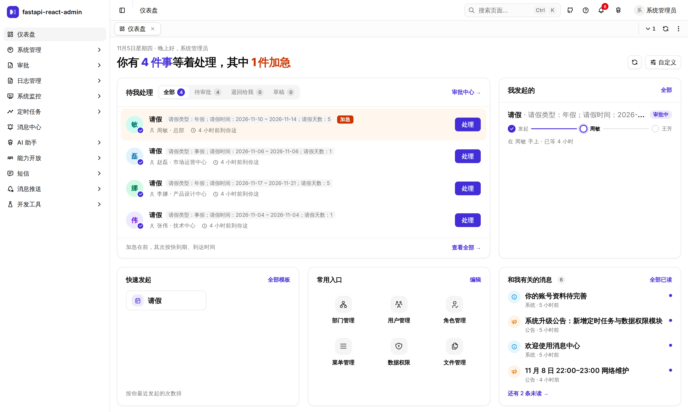
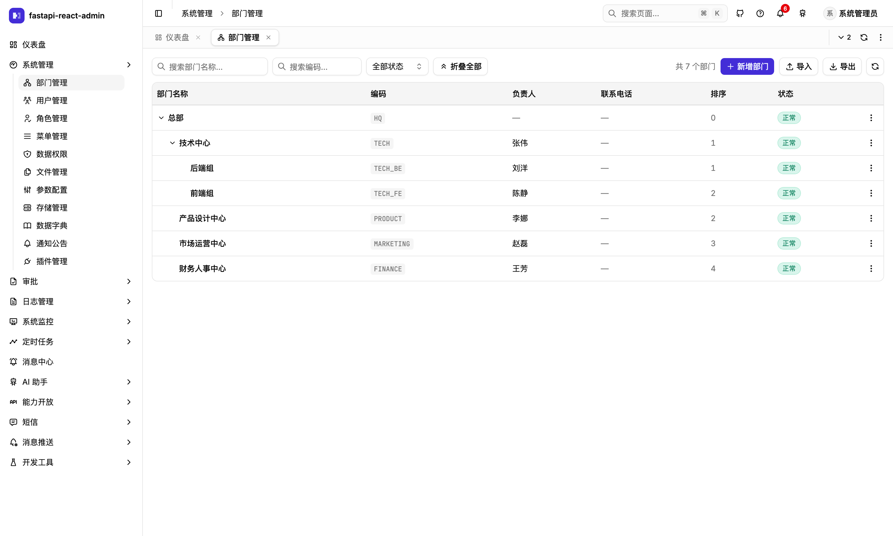
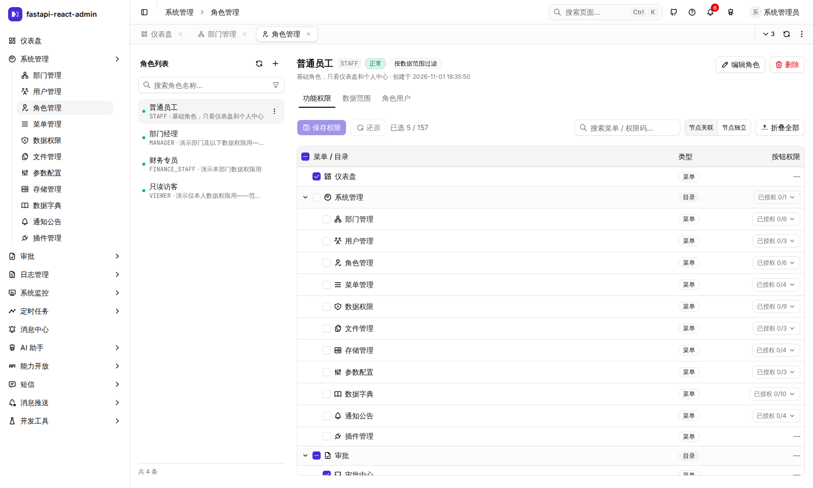
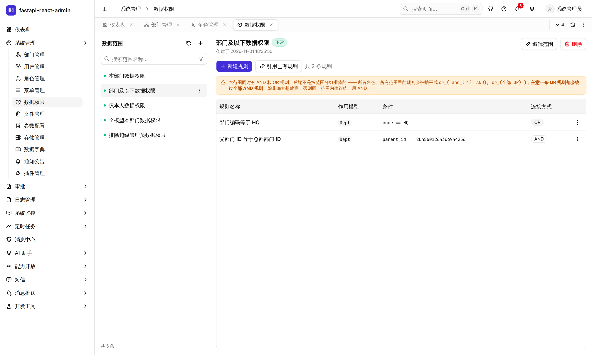
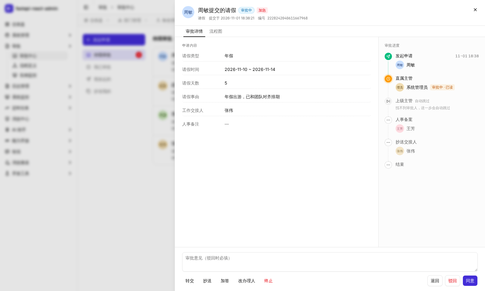
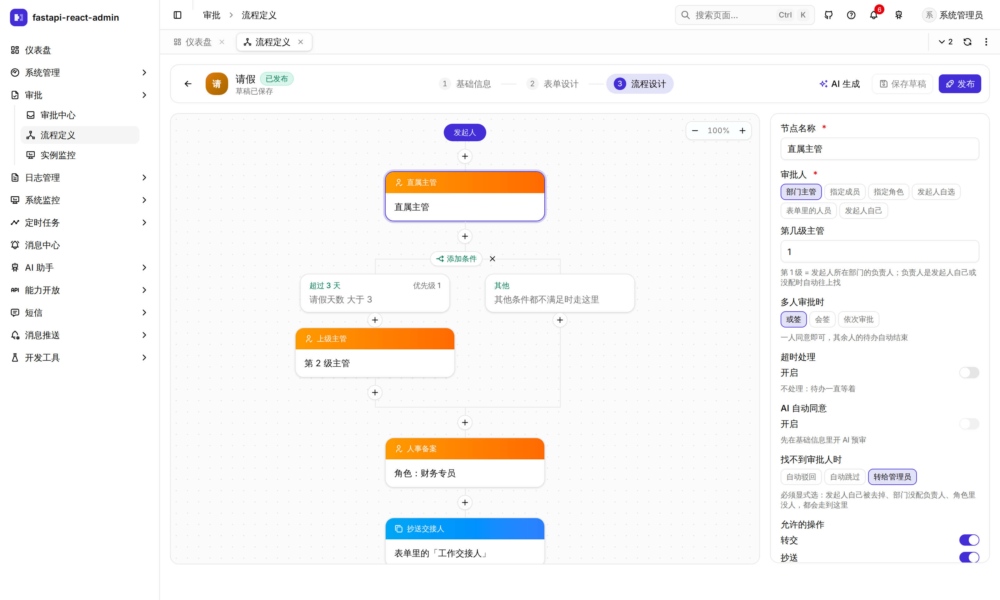

<div align="center">


# fastapi-react-admin

**English** | [简体中文](./README.zh-CN.md)

**A batteries-included admin foundation · FastAPI + React 19 + shadcn/ui**

Row-level permissions · multi-tab that keeps state · approval workflow · an AI assistant that can't overreach · S3 storage with resumable uploads · web, desktop and mobile

[Live demo](https://fra.wubunan.com/sign-in) · [Docs](https://yilecoding.github.io/fastapi-react-admin/en/) · [Quick start](#quick-start) · [Features](#features) · [Releases](https://github.com/yilecoding/fastapi-react-admin/releases)

[](https://github.com/yilecoding/fastapi-react-admin/releases)
[](https://github.com/yilecoding/fastapi-react-admin/actions/workflows/ci.yml)
[](https://yilecoding.github.io/fastapi-react-admin/e2e/)
[](./LICENSE)

</div>

> 🚀 Demo account `admin` / `123456` — a public instance anyone can log into; data may be changed or wiped by other visitors, so don't store anything real.

<table>
<tr>
<td width="50%"></td>
<td width="50%"></td>
</tr>
<tr>
<td width="50%"></td>
<td width="50%"></td>
</tr>
<tr>
<td width="50%"></td>
<td width="50%"></td>
</tr>
</table>

## 🌱 Why build it?

**One rewrite, distilled into a base you can start writing business logic on.**

AI has made writing code faster, and there are more systems to build because of it: small tools that never made the roadmap are now worth doing, and systems that have run for years are due for a replacement. Yet the first weeks of every new system go to the same list — login, permissions, org structure, approvals, files, notifications.

This project started as a rewrite of a few small Java + Vue 2 systems at work. Rather than patch the old architecture, we rebuilt them on FastAPI + React 19 and distilled everything that gets rebuilt every time into a base. **The next system starts with business logic.**

### One repo for web, desktop and mobile

The backend, the web admin console, a desktop template, a mobile template and the docs site live in one pnpm + turbo monorepo: install once, and one `pnpm dev` starts backend and frontend.

```
apps/
├── api        backend · FastAPI + Celery
├── web        web admin console · React 19
├── desktop    desktop template · Electron
├── mobile     mobile template · Expo / React Native
└── docs       docs site · Astro
packages/      one-way deps: i18n / api ← ui ← platform ← web
├── api        frontend/backend type contract, generated from OpenAPI
├── i18n       Chinese / English strings
├── ui         component library, no business logic, portable as a whole
└── platform   permissions, multi-tab, business pages
```

- **The web admin console** is the core, ready to use
- **The desktop template** loads the web build and only adds what a browser can't do: silent printing, local hardware, auto-update
- **The mobile template** has native screens and shares the API types and translations with web
- **The layering is enforced**: dependencies flow one way, and `pnpm arch:check` checks it in CI

### Built for working with AI

AI changes code fast, so every change needs something to catch it:

- **Tests** — 1,600+ tests against a real database and a real browser, no mocks, on every CI run; the [E2E report](https://yilecoding.github.io/fastapi-react-admin/e2e/) is public
- **Types** — frontend/backend types are generated from OpenAPI, so an API change the pages didn't follow fails type checking
- **Rules written for AI** — 50+ per-directory `CLAUDE.md` / `AGENTS.md` files record pitfalls found by testing; a coding assistant reads the one for whatever directory it edits
- **A backend inside the AI ecosystem** — Python + FastAPI, with the built-in AI assistant on pydantic-ai

## ✨ Why this one

- **Permissions down to which rows you see** — beyond menus and buttons there are data scopes: on the same user table, a department manager only sees their own department. Rules live on model columns, and the UI warns you when a rule is misconfigured
- **Tabs that keep their state** — built on React 19's `<Activity>`: a half-filled form, the page you were on, an expanded tree are all still there when you switch back; view state lives in the URL, so a refresh doesn't lose it either
- **Approval workflow out of the box** — a Feishu-style form designer and flow tree, with or-sign / co-sign, send back, add approvers, take back and timeouts
- **An AI assistant that can't overreach** — it can do exactly what the signed-in user can do; write actions are previewed and only run after the user confirms, and every call is audited. External systems can reach the same tools through an MCP gateway
- **Large files, handled** — local disk or S3-compatible storage, instant upload by hash, parallel chunks, resume after a page refresh, and one upload tray for everything in flight
- **Pick your database** — PostgreSQL, SQL Server or MySQL, same code
- **Beyond the browser** — an Electron desktop app (installers for three platforms with auto-update) and a native mobile app
- **Tested for real** — 1,600+ tests against real databases and a real browser; CI runs the full backend suite on both PostgreSQL and SQL Server

## How it compares

| | Typical template | Here |
|---|---|---|
| **Permission granularity** | menus + buttons | menus + buttons + **data scopes** — the role decides which **rows** you see |
| **Multi-tab** | free with Vue's `keep-alive`; most React templates don't have it, or lose state when you switch away | React 19 **`<Activity>`**: open tabs stay mounted, DOM and state survive switching |
| **Component base** | most are still on shadcn's older Radix version | already on **Base UI**, shadcn's current default (zero `@radix-ui` imports), plus a component sandbox you can copy code from |
| **Database** | usually just one | **pick one of three**: PostgreSQL (default) · SQL Server · MySQL |
| **Business features** | users / roles / menus | plus approval workflow, AI assistant, open API, files & storage, messaging and scheduled jobs |
| **Tests** | mostly none, or component unit tests with mocks | 1,400+ backend + 150+ end-to-end browser tests, **against real dependencies, no mocks** |

## Features

| Area | What you get |
|---|---|
| **Access & org** | RBAC (menus / buttons / data scopes) · row-level data permissions · department tree · users & roles |
| **Import & export** | server-side xlsx / csv export (current filter or selected rows · large exports run in the background and notify you when done · formula-injection safe) · generic import (templates with dropdowns · preview & validation · insert only / upsert / update only · error report · all-or-nothing) · build a whole department tree from one file |
| **Sign-in & security** | captcha · lockout · password history & expiry · SMS code sign-in · two-factor auth (TOTP + recovery codes) · OAuth2 (GitHub / Google) · session management (idle timeout + absolute limit · per-client session caps · tells users why they were signed out · force sign-out) |
| **Workspace** | customizable dashboard (cards appear by permission · layout saved per user on the server) · multi-tab (pin / drag / reload) · command palette ⌘K · shortcuts · guided tour · theme / radius / tab style · per-user time zone · Chinese & English |
| **Files & storage** | file manager with previews (pdf / docx / xlsx / images / archives) · local + S3-compatible storage · pre-signed downloads · recycle bin · instant upload · chunked & resumable uploads · attachment panel for any page |
| **Approval workflow** | form designer · flow tree (approve / CC / conditional branches) · approve / reject / transfer / send back / take back / add approvers · timeout reminders and auto-actions · drafts · urgent · handover · AI pre-review / form filling / AI approval nodes |
| **AI assistant** | full-page chat + side drawer · tool calls bound by permissions and data scopes · preview + confirm for writes · audit log · MCP gateway |
| **Open API** | AK/SK-signed endpoints · scopes / IP allow-list / replay protection / rate limits · call logs · incremental sync · Python / Node / Java SDKs · webhook subscriptions (Standard Webhooks signatures · retries · delivery log · bulk resend) |
| **Messages & notifications** | in-app notifications (real-time) · notices (rich text + attachments · audiences · scheduled publishing · pinned / level / expiry · pop-up after sign-in with required acknowledgement · top banner · sign-in page notices · read stats) · notification routing (email / SMS / Feishu · DingTalk · WeCom group bots · per-event policies · delivery log) · SMS (Alibaba Cloud / Tencent Cloud) |
| **Scheduled jobs** | online scheduling · cron preview · run history |
| **Operations** | settings · dictionaries · sign-in / operation logs (redacted) · server & Redis monitoring · new-version prompt |
| **Clients** | Electron desktop (installers for three platforms · silent printing · local hardware · auto-update) · native Expo app (not a WebView wrapper; scope below) |
| **Developers** | component sandbox (every component tweakable and copy-pasteable) · color palette · type-safe API contract generated from OpenAPI |

## Stack

| | |
|---|---|
| **Frontend** | React 19 · TypeScript 6 · Vite 8 · TanStack Router / Query / Table v9 · Tailwind CSS 4 · shadcn/ui (Base UI) · zustand · Tiptap 3 · i18next |
| **Backend** | FastAPI · Pydantic 2 · SQLAlchemy 2 (async) · Alembic · Redis · Celery · Socket.IO · Apache OpenDAL · pydantic-ai |
| **Databases** | PostgreSQL · SQL Server · MySQL |
| **Clients** | Electron 42 · Expo 57 / React Native 0.86 |
| **Tooling** | pnpm + turbo monorepo · uv · ruff · pytest · Playwright · GitHub Actions |

## Mobile app

The Expo app covers **the things people actually do on a phone** ([#224](https://github.com/yilecoding/fastapi-react-admin/issues/224)); admin-console modules stay on the web. It is versioned separately from the web app.

- **Has:** home (my approvals · to-do) · approvals (to-do / done / CC'd / started by me · approve / reject / send back / transfer / add signer · start a request · drafts · resubmit after send-back · restart a closed request) · notices · notifications · users · profile (bind a phone number) · server monitoring · time zone · SMS code sign-in · two-factor sign-in · session expiry reasons
- **Web only, by design:** roles / departments / menus · files · operation & sign-in logs · turning on two-factor auth · AI form filling and AI pre-review in approvals
- **Not yet verified:** no automated tests ([#137](https://github.com/yilecoding/fastapi-react-admin/issues/137)), most screens only run on an emulator, no release pipeline

## Databases

Switch with `DATABASE_TYPE` in `.env` — same code, same migration chain, seed data for all three.

| | Good for | How it's verified |
|---|---|---|
| **PostgreSQL** (default) | new projects; `docker compose up` gives you one | full backend suite on every CI run |
| **SQL Server** | teams already on the Microsoft stack | full backend suite + browser E2E on every CI run |
| **MySQL** | teams already running MySQL | not in CI; full suite run locally on demand — last run (2026-10-31) passed in full, including an upgrade from v0.0.1 |

## Quick start

You need Node ≥ 22.13, Python ≥ 3.10, [uv](https://docs.astral.sh/uv/) and Docker.

```bash
docker compose -f docker-compose.dev.yml up -d          # PostgreSQL + Redis
pnpm install:all                                        # frontend + backend dependencies
cp apps/api/backend/.env.example apps/api/backend/.env  # defaults match the containers above
pnpm db:init                                            # create tables + seed data (first run)
pnpm dev                                                # open http://127.0.0.1:8888
```

Sign in as `admin` with the password you set during `pnpm db:init`. Switching to SQL Server / MySQL, S3, skipping the captcha and running tests are covered in [CONTRIBUTING.md](./CONTRIBUTING.md#本地开发) (Chinese; the commands are language-independent).

## Quality

1,400+ backend pytest tests run against a real database and Redis; 150+ Playwright tests drive a real browser against the real API and database — **no mocks**.
Data permissions were verified by signing in as 41 real accounts one by one; key safeguards are mutation-tested (break the code on purpose, confirm the tests go red).
The [E2E report](https://yilecoding.github.io/fastapi-react-admin/e2e/) from every `main` run is public, with screenshots and videos of failures.

## Docs

| To… | Read |
|---|---|
| get started step by step: quick start, deployment, your first module, FAQ, upgrading | [docs site](https://yilecoding.github.io/fastapi-react-admin/en/) |
| develop locally, run tests, open a PR, release | [CONTRIBUTING.md](./CONTRIBUTING.md) |
| learn the engineering rules and pitfalls | [CLAUDE.md](./CLAUDE.md) — task-indexed, 40+ module notes, every claim backed by a test or measurement |
| deploy to a server | [deploy/README.md](./deploy/README.md) |
| desktop app | [apps/desktop/README.md](./apps/desktop/README.md) |
| integrate with the open API | [apps/api/backend/plugin/open/README.md](./apps/api/backend/plugin/open/README.md) |
| reuse the component library | [packages/ui/PORTING.md](./packages/ui/PORTING.md) |
| security notes | [SECURITY.md](./SECURITY.md) |

## License

[MIT](./LICENSE)

## Acknowledgements

The backend was originally built on [fastapi-best-architecture](https://github.com/fastapi-practices/fastapi_best_architecture) (FBA) — its three-layer structure, plugin system and RBAC / data-scope model come from FBA's design. Thanks to its author and contributors 🙏 FBA is also MIT-licensed; its original copyright notice is kept in [`apps/api/LICENSE`](./apps/api/LICENSE). Thanks also to [shadcn/ui](https://github.com/shadcn-ui/ui), [TanStack](https://github.com/TanStack), [Tiptap](https://github.com/ueberdosis/tiptap), [file-viewer](https://github.com/flyfish-dev/file-viewer) and the other open-source projects this is built on.
