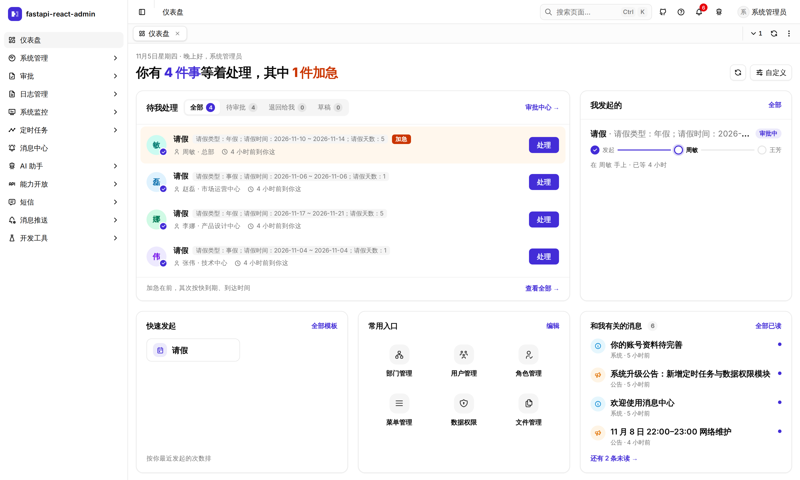
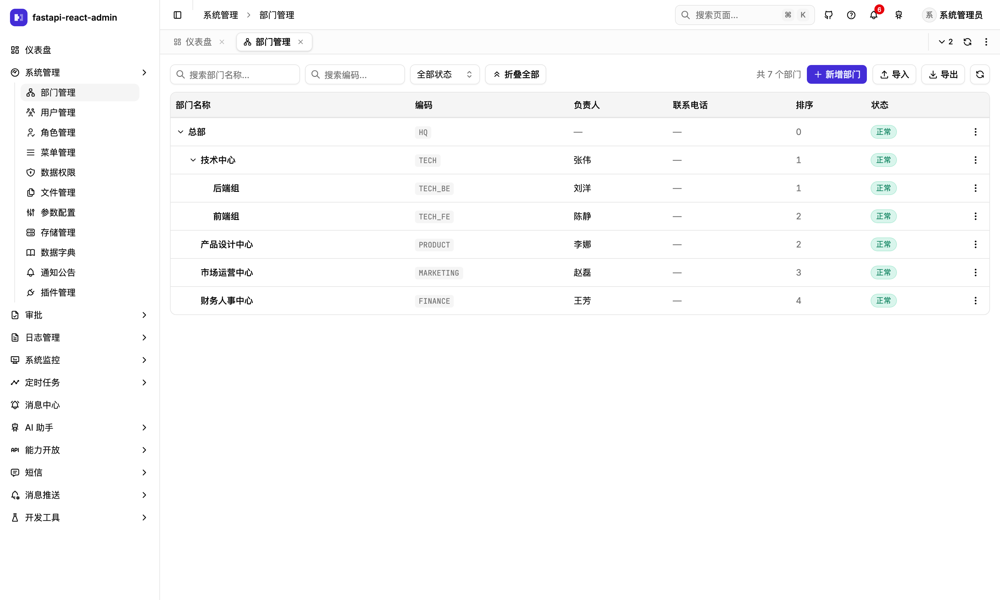
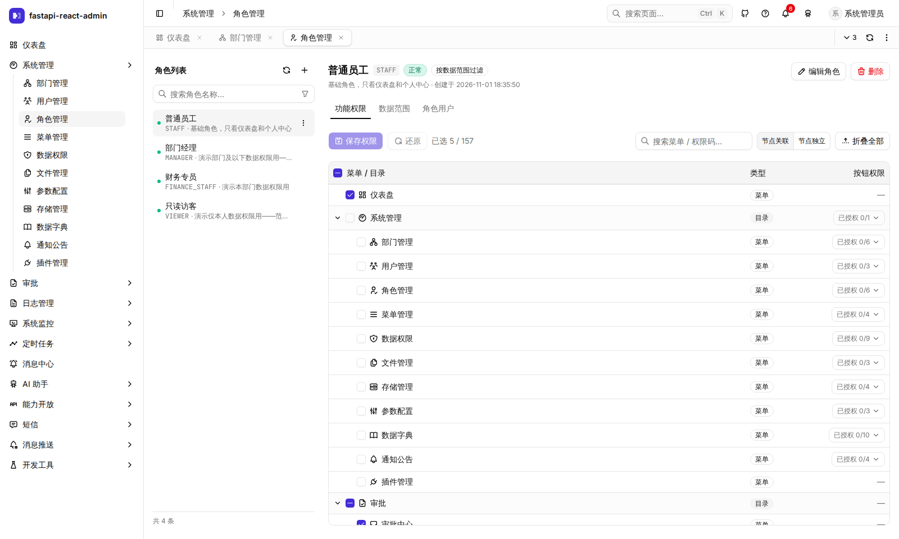
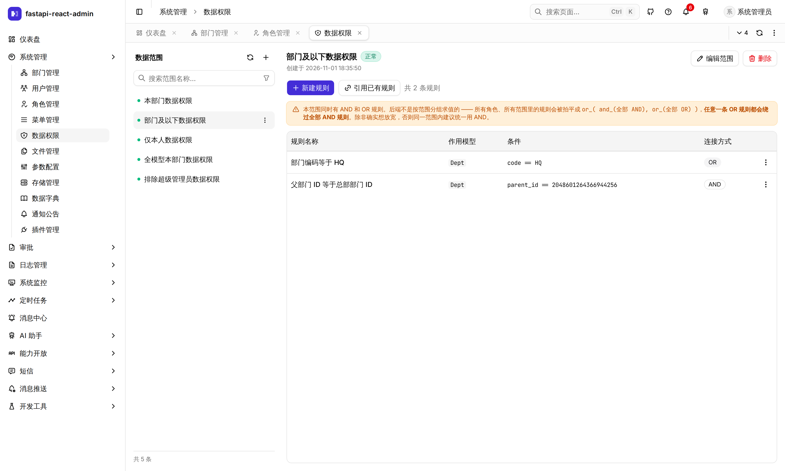
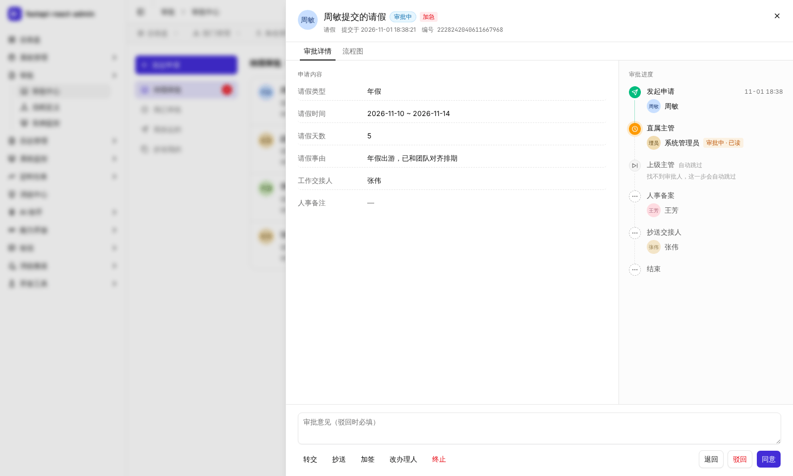
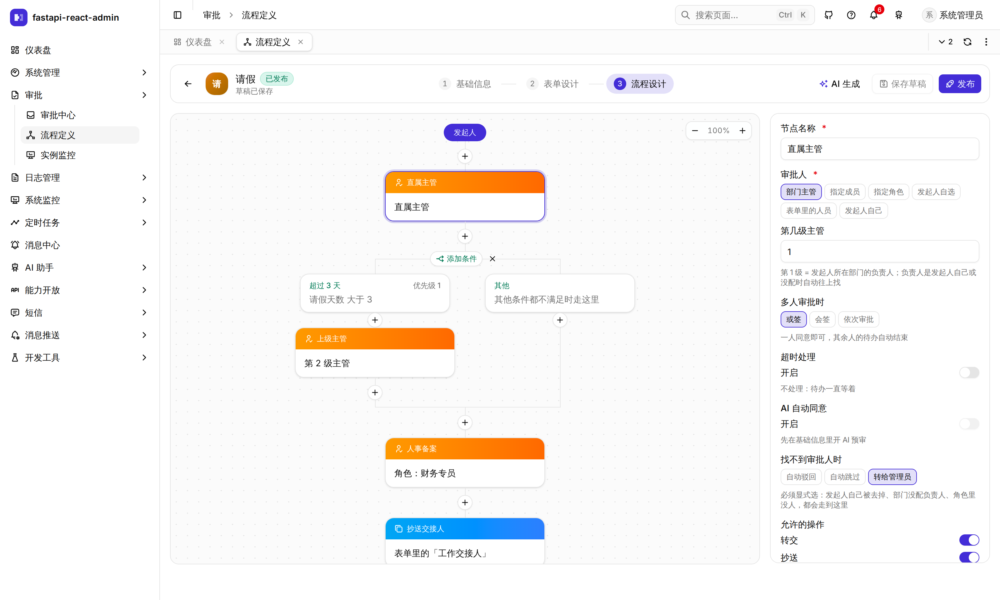

<div align="center">


# fastapi-react-admin

[English](./README.md) | **简体中文**

**开箱即用的中后台底座 · FastAPI + React 19 + shadcn/ui**

权限细到数据行 · 多页签真保状态 · 飞书式审批 · 不越权的 AI 助手 · S3 存储与断点续传 · Web / 桌面 / 移动三端

[在线演示](https://fra.wubunan.com/sign-in) · [文档](https://yilecoding.github.io/fastapi-react-admin/) · [快速开始](#快速开始) · [功能一览](#功能一览) · [更新记录](https://github.com/yilecoding/fastapi-react-admin/releases)

[](https://github.com/yilecoding/fastapi-react-admin/releases)
[](https://github.com/yilecoding/fastapi-react-admin/actions/workflows/ci.yml)
[](https://yilecoding.github.io/fastapi-react-admin/e2e/)
[](./LICENSE)

</div>

> 🚀 在线演示账号 `admin` / `123456` —— 公开实例，任何人都能登录，数据会被访客改动或清空，请勿存放真实信息。

<table>
<tr>
<td width="50%"></td>
<td width="50%"></td>
</tr>
<tr>
<td width="50%"></td>
<td width="50%"></td>
</tr>
<tr>
<td width="50%"></td>
<td width="50%"></td>
</tr>
</table>

## 🌱 为什么做它

**一次重构，沉淀成一个拿来就能写业务的底座。**

AI 让写代码变快了，要做的系统反而更多了：排不上队的小工具值得做了，跑了多年的老系统也该换了。可每个新系统的头几周，都在重复同一批活——登录、权限、组织架构、审批、文件、通知。

这个项目起步于公司里几套 Java + Vue 2 小系统的重构。我们没有在旧架构上修补，而是用 FastAPI + React 19 从头搭了一遍，再把每次都要重做的部分沉淀成底座。**下一个系统，从写业务开始。**

### 一个仓库，覆盖 Web、桌面和手机

后端、Web 后台、桌面端模板、移动端模板和文档站都在一个 pnpm + turbo monorepo 里：一次安装，`pnpm dev` 一条命令起前后端。

```
apps/
├── api        后端 · FastAPI + Celery
├── web        Web 管理后台 · React 19
├── desktop    桌面端模板 · Electron
├── mobile     移动端模板 · Expo / React Native
└── docs       文档站 · Astro
packages/      依赖单向：i18n / api ← ui ← platform ← web
├── api        前后端类型契约，由 OpenAPI 生成
├── i18n       中英文案
├── ui         组件库，不含业务，可整包带走
└── platform   权限、多页签、业务页面
```

- **Web 管理后台**是主体，开箱即用
- **桌面端模板**直接加载 Web 的构建产物，只补浏览器做不到的事：静默打印、本地硬件、自动更新
- **移动端模板**是原生界面，和 Web 共用接口类型与语言包
- **分层有约束**：依赖严格单向，`pnpm arch:check` 在 CI 里把关

### 为 AI 协作而设计

AI 改代码很快，所以每一处改动都得有东西兜底：

- **测试兜底** —— 1600+ 条测试连真实数据库、跑真实浏览器，不用 mock；CI 每次全量跑，[E2E 报告](https://yilecoding.github.io/fastapi-react-admin/e2e/)公开
- **类型兜底** —— 前后端契约由 OpenAPI 生成；移动端的请求全部从它推断类型，接口改了而页面没跟上，类型检查直接报错（网页端还在迁移，请求的返回类型目前在各调用点手写）
- **规矩写给 AI 看** —— 50 多份按目录拆分的 `CLAUDE.md` / `AGENTS.md` 记着实测踩过的坑，编码助手改到哪个目录，就读到哪一份
- **后端就在 AI 生态里** —— Python + FastAPI，内置的 AI 助手基于 pydantic-ai

## ✨ 为什么选它

- **权限细到「能看到哪些行」** —— 菜单、按钮之外还有数据范围：同一张用户表，部门经理只看得到自己部门的人。
  规则配在模型的列上，配错了界面会直接提示
- **多页签切走不丢状态** —— 基于 React 19 的 `<Activity>`：填了一半的表单、翻到的页码、展开的树，切回来都还在；
  视图状态写进 URL，刷新也不丢
- **审批流开箱即用** —— 飞书式表单设计器 + 流程树，或签 / 会签、退回、加签、拿回、超时自动处理都有
- **AI 助手不会越权** —— 它能做的事 = 当前登录的人能做的事；写操作先预演、本人确认才执行，全程留审计。
  外部系统还能通过 MCP 网关调用同一套能力
- **大文件也好传** —— 本地盘或 S3 兼容存储，秒传、分片并发、刷新后断点续传，右下角一个上传浮窗看全部进度
- **数据库三选一** —— PostgreSQL、SQL Server、MySQL，同一套代码
- **不止网页** —— Electron 桌面端（三平台安装包 + 自动更新）和原生移动 App
- **质量有底** —— 1600+ 条测试打真实数据库和真实浏览器，CI 上后端全套在 PostgreSQL 和 SQL Server 各跑一遍

## 和常见模板的区别

| | 常见做法 | 这里 |
|---|---|---|
| **权限粒度** | 菜单 + 按钮 | 菜单 + 按钮 + **数据范围**，角色决定能看到哪些**行** |
| **多页签** | Vue 靠 `keep-alive` 白送；React 侧大多没有，或者切走就丢状态 | React 19 **`<Activity>`**：已开的页签同时挂载，切走保留 DOM 与状态 |
| **组件基座** | 多数还停在 shadcn 迁移前的 Radix 版本 | 已跟进 shadcn 现在的默认底座 **Base UI**（`@radix-ui` 零引用），附可直接抄代码的组件沙箱 |
| **数据库** | 通常只支持一种 | **三选一**：PostgreSQL（默认）· SQL Server · MySQL |
| **业务能力** | 用户 / 角色 / 菜单 | 另有审批流、AI 助手、开放接口、文件与存储、消息与定时任务 |
| **测试** | 大多不带，带的也多停在组件单测 + mock | 后端 1400+ 条 + 前端 150+ 条端到端测试，**打真实依赖，不 mock** |

## 功能一览

| 模块 | 能做什么 |
|---|---|
| **权限与组织** | RBAC（菜单 / 按钮 / 数据范围）· 行级数据权限 · 部门树 · 用户与角色 |
| **导入导出** | 服务端导出 xlsx / csv（按当前筛选或勾选的行 · 大批量转后台、完成发站内消息 · 防公式注入）· 通用导入（带下拉的模板 · 预览校验 · 只新增 / 新增并更新 / 只更新 · 错误报告 · 全部成功才导入）· 一份文件建整棵部门树 |
| **登录与安全** | 图形验证码 · 失败锁定 · 密码历史与过期 · 手机验证码登录 · 二次验证（TOTP + 恢复码）· OAuth2（GitHub / Google）· 会话管理（空闲超时 + 绝对上限 · 按端限制会话数 · 被踢下线说明原因 · 强制下线） |
| **工作区** | 可编辑布局的工作台（卡片按权限出现 · 布局按人存服务端）· 多页签（固定 / 拖拽 / 重新加载）· 命令面板 ⌘K · 快捷键 · 功能引导 · 列表列显隐与拖拽排序（写进地址栏）· 主题色 / 圆角 / 页签外观 · 每人自己的时区 · 中英双语 |
| **文件与存储** | 文件管理器 + 在线预览（pdf / docx / xlsx / 图片 / 压缩包）· 本地 + S3 兼容存储 · 预签名直连下载 · 回收站 · 秒传 · 分片上传与断点续传 · 可嵌进任何页面的附件面板 |
| **审批流** | 表单设计器 · 流程树（审批 / 抄送 / 条件分支）· 同意 / 驳回 / 转交 / 退回 / 拿回 / 加签 · 超时提醒与自动处理 · 草稿 · 加急 · 离职交接 · AI 预审 / 帮填表单 / AI 审批节点 |
| **AI 助手** | 整页对话 + 侧滑抽屉 · 受权限与数据范围约束的工具调用 · 写操作预演 + 确认 · 调用审计 · MCP 网关 |
| **能力开放** | AK/SK 签名的开放接口 · scope / IP 白名单 / 防重放 / 限流 · 调用日志 · 增量同步 · Python / Node / Java SDK · Webhook 事件订阅（Standard Webhooks 签名 · 失败重试 · 投递记录 · 批量重发） |
| **消息与通知** | 站内消息（实时推送）· 通知公告（富文本 + 附件 · 发布范围 · 定时发布 · 置顶 / 级别 / 有效期 · 登录后弹窗与必须确认 · 顶部横幅 · 登录页公告 · 阅读统计）· 通知渠道路由（邮件 / 短信 / 飞书·钉钉·企业微信群机器人 · 按事件配策略 · 投递记录）· 短信（阿里云 / 腾讯云） |
| **定时任务** | 在线调度 · cron 预览 · 执行记录 |
| **运维** | 参数配置 · 数据字典 · 登录 / 操作日志（自动脱敏）· 数据变更记录（谁、什么时候、从哪来，把哪个字段从什么改成了什么 · 和操作日志互跳）· 服务器与 Redis 监控 · 发新版提示 |
| **多端** | Electron 桌面端（三平台安装包 · 静默打印 · 本地硬件 · 自动更新）· Expo 原生移动 App（不是 WebView 套壳；范围见下方说明） |
| **开发者** | 组件沙箱（每个组件可调、可抄）· 调色盘 · 由 OpenAPI 生成的类型安全前后端契约 |

## 技术栈

| | |
|---|---|
| **前端** | React 19 · TypeScript 6 · Vite 8 · TanStack Router / Query / Table v9 · Tailwind CSS 4 · shadcn/ui（Base UI）· zustand · Tiptap 3 · i18next |
| **后端** | FastAPI · Pydantic 2 · SQLAlchemy 2（async）· Alembic · Redis · Celery · Socket.IO · Apache OpenDAL · pydantic-ai |
| **数据库** | PostgreSQL · SQL Server · MySQL |
| **多端** | Electron 42 · Expo 57 / React Native 0.86 |
| **工程** | pnpm + turbo 单仓 · uv · ruff · pytest · Playwright · GitHub Actions |

## 移动端

Expo App 的范围是**手机上真正要办的事**（[#224](https://github.com/yilecoding/fastapi-react-admin/issues/224)）；管理后台类的模块不搬，用 Web。版本号和 Web 分开编。

- **有**：首页（我的审批 · 待办）· 审批（待办 / 已办 / 抄送 / 我发起的 · 同意 / 驳回 / 退回 / 转交 / 加签 · 发起 · 草稿 · 退回后重新提交 · 重新发起）· 公告 · 消息 · 用户 · 个人中心（绑定手机号）· 服务器监控 · 时区 · 手机验证码登录 · 二次验证登录 · 会话结束原因提示
- **移动端不做，用 Web**：角色 / 部门 / 菜单 · 文件 · 操作日志与登录日志 · 开启二次验证 · 审批里的 AI 帮填与 AI 预审
- **还没验证**：没有自动化测试（[#137](https://github.com/yilecoding/fastapi-react-admin/issues/137)）· 多数页面只在模拟器上跑过 · 没有发版流水线

## 数据库：三选一

改 `.env` 里的 `DATABASE_TYPE` 就能换，同一套代码、同一条迁移链，三种库各有一份初始数据。

| | 适合 | 验证情况 |
|---|---|---|
| **PostgreSQL**（默认） | 新项目首选，本地 `docker compose up` 就有 | CI 每次跑后端全套 |
| **SQL Server** | 已有微软技术栈的企业 | CI 每次跑后端全套 + 前端端到端 |
| **MySQL** | 已有 MySQL 运维的团队 | 不在 CI 里，按需本地跑全套；最近一次（2026-10-31）全部通过，含从 v0.0.1 升级上来的库 |

## 快速开始

需要 Node ≥ 22.13、Python ≥ 3.11、[uv](https://docs.astral.sh/uv/) 和 Docker。

```bash
docker compose -f docker-compose.dev.yml up -d          # PostgreSQL + Redis
pnpm install:all                                        # 前后端依赖
cp apps/api/backend/.env.example apps/api/backend/.env  # 默认配置已对齐上面的容器
pnpm db:init                                            # 建表 + 初始数据（首次）
pnpm dev                                                # 打开 http://127.0.0.1:8888
```

账号 `admin`，密码是 `pnpm db:init` 时设的。换 SQL Server / MySQL、接 S3、跳过验证码、跑测试，见[本地开发指南](./CONTRIBUTING.md#本地开发)。

部署到服务器：`main` 每次通过 CI 都会构建好镜像，服务器上 `bash prod.sh pull && bash prod.sh up` 即可更新，见 [`deploy/README.md`](./deploy/README.md)。

## 质量

后端 1400+ 条 pytest 打真实数据库和 Redis，前端 150+ 条 Playwright 打真实浏览器、真实接口和真实库 —— **不 mock**。
数据权限是拿 41 个真账号逐个登录验证出来的；关键防线都做过变异检验（故意把代码改坏，确认测试会红）。
`main` 每次跑完的 [E2E 报告](https://yilecoding.github.io/fastapi-react-admin/e2e/) 都公开，失败用例带截图和录像。

## 文档

| 想做什么 | 看这里 |
|---|---|
| 从零上手：快速开始、部署、写第一个业务模块、常见问题、版本升级 | [文档站](https://yilecoding.github.io/fastapi-react-admin/)（演示站上也有一份：[fra.wubunan.com/docs](https://fra.wubunan.com/docs/)） |
| 本地开发、跑测试、提 PR、发版 | [CONTRIBUTING.md](./CONTRIBUTING.md) |
| 了解工程约定和踩过的坑 | [CLAUDE.md](./CLAUDE.md) —— 按任务导航，40 多份模块分册，每条结论都带实测证据 |
| 部署到服务器 | [deploy/README.md](./deploy/README.md) |
| 桌面端 | [apps/desktop/README.md](./apps/desktop/README.md) |
| 对接开放接口 | [apps/api/backend/plugin/open/README.md](./apps/api/backend/plugin/open/README.md) |
| 把组件库搬进别的项目 | [packages/ui/PORTING.md](./packages/ui/PORTING.md) |
| 安全须知 | [SECURITY.md](./SECURITY.md) |

## 许可

[MIT](./LICENSE)

## 致谢

感谢 [fastapi-best-architecture](https://github.com/fastapi-practices/fastapi_best_architecture) 的作者和贡献者 🙏
也感谢 [shadcn/ui](https://github.com/shadcn-ui/ui)、[TanStack](https://github.com/TanStack)、[Tiptap](https://github.com/ueberdosis/tiptap)、[file-viewer](https://github.com/flyfish-dev/file-viewer) 等开源项目。
