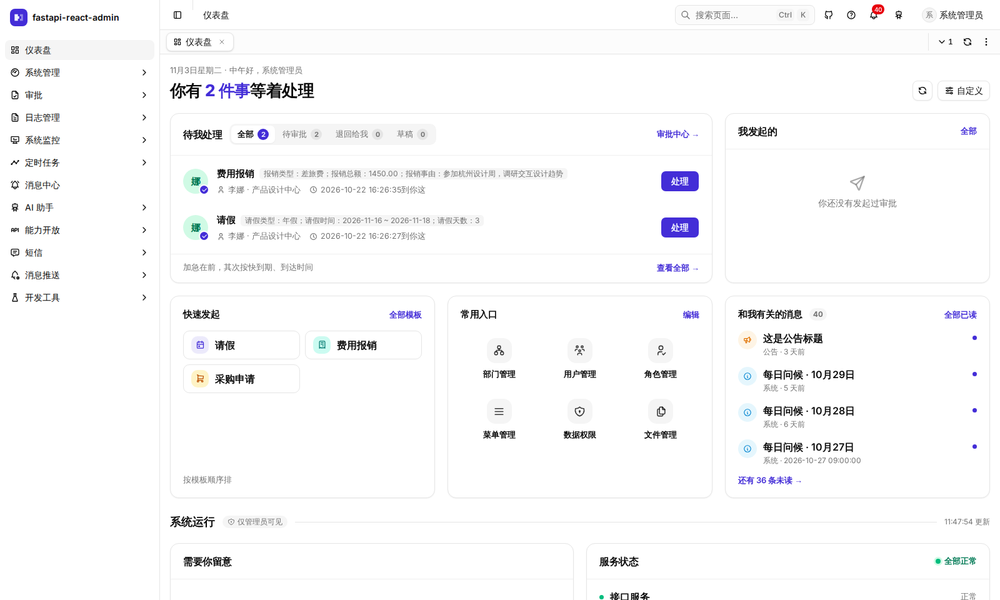
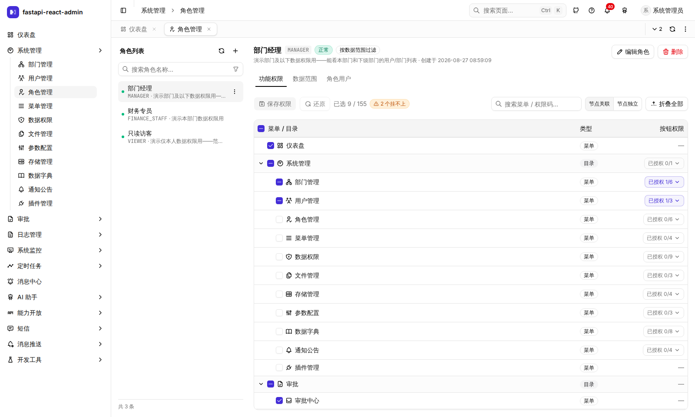
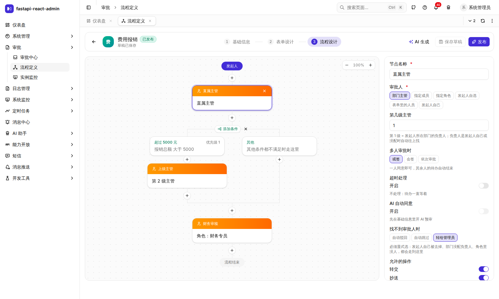

# 发布素材

掘金发文时要填的东西，加上 V2EX、HelloGitHub 的短文。长文本身见 `00` / `01` / `02`，发布顺序和时间见 `PUBLISH-PLAN.md`。

## 掘金：每篇要填的

| | 00 系统介绍 | 01 Activity 多页签 | 02 雪花 ID |
|---|---|---|---|
| 分类 | 后端 | 前端 | 后端 |
| 标签 | FastAPI · Python · 开源 | React.js · 前端 | Python · JavaScript |
| 封面 | `images/cover-00.png`（登录页，3:2，掘金建议 192×128） | `images/00-tabs.gif` 的第一帧，或不放 | 不放 |

分类的考虑：前端分类文章最多，一篇项目介绍很容易被刷下去；后端分类里讲 FastAPI 的少，选底座的人也多半在后端。01 讲的就是 React，留在前端。不放「人工智能」：AI 只是其中一个功能，挂上去会显得在蹭热度。

**摘要**（掘金要求 50～100 字，默认会自动截正文前 100 字，要整段替换掉）：

- 00：一个 FastAPI + React 19 的开源中后台底座：权限细到数据行、多页签切走不丢状态、飞书式审批流、不越权的 AI 助手。这篇介绍它的功能、架构分层、关键设计和工程化做法。
- 01：React 19.2 的 `<Activity>` 终于能让多页签真正保活，但它带来的问题大多是静默出错。这篇记录 6 个坑：Outlet 卸载、后台页签读不到路由、effect 重建、重新加载失效、隐藏 DOM、URL 抽屉乱飘。
- 02：后端把雪花 ID 转成字符串，只堵住了第一个出口。路由库、业务代码里的 `Number()`、类型系统、Excel 导出都会丢精度。一个 19 位 ID 被改了一位，权限就存到了别的角色身上。

**发之前**：正文里的图片地址是 GitHub raw，国内经常打不开。把 `images/` 里的图逐张拖进掘金编辑器，替换掉原来的链接。

## V2EX「分享创造」

只发一次，11/3 周二 15:00 发。15:00～17:00 守着回帖。

**标题**：开源了一个 FastAPI + React 19 的中后台底座：权限细到数据行，多页签切走不丢状态

**正文**：

```markdown
做后台项目总要从头搭一遍用户、角色、菜单、审批，干脆整理成一个底座开源出来，今天发了 1.0。

GitHub：https://github.com/yilecoding/fastapi-react-admin
在线演示：https://fra.wubunan.com （admin / 123456，公开实例，数据随时可能被别人改）

和常见模板不太一样的几个地方：

- 权限除了菜单和按钮，还能控制「看到哪些行」：同一张用户表，部门经理只看得到自己部门的人
- 多页签用 React 19.2 的 <Activity> 做，填了一半的表单切走再回来还在
- 自带飞书式审批流：表单设计器 + 流程树，或签 / 会签、退回、加签、超时自动处理
- AI 助手只能做当前登录的人能做的事，写操作先预演、本人确认后才执行（演示站没配大模型密钥，这个要自己部署后填 key 才能试）
- PostgreSQL / SQL Server / MySQL 三选一；除了 Web 还有 Electron 桌面端，移动端是预览版
- 后端 1400+ 条、端到端 150+ 条测试，打真实数据库，不 mock

技术栈：FastAPI · SQLAlchemy 2 · Celery · React 19 · TanStack Router / Query · shadcn/ui（Base UI）。后端从 fastapi-best-architecture 分叉而来。MIT 协议。





还有不少粗糙的地方，欢迎试用、提 issue。也想听听大家做后台时最头疼的是什么。
```

图片用的是 `blog` 分支的 raw 地址，**发帖前 `blog` 分支要先推送**，否则图是裂的。

## HelloGitHub 自荐

在 https://hellogithub.com 提交。类别选 Python。

**一句话**：开箱即用的 FastAPI + React 19 中后台底座

**描述**：

> 权限能细到数据行：同一张表，不同角色看到不同的行。多页签基于 React 19.2 的 `<Activity>`，切走不丢状态。自带飞书式审批流，还有一个不越权的 AI 助手：它只能做当前用户能做的事，写操作要本人确认。支持 PostgreSQL / SQL Server / MySQL，附 Electron 桌面端。1400+ 后端测试和 150+ 端到端测试都连真实数据库，不 mock。
