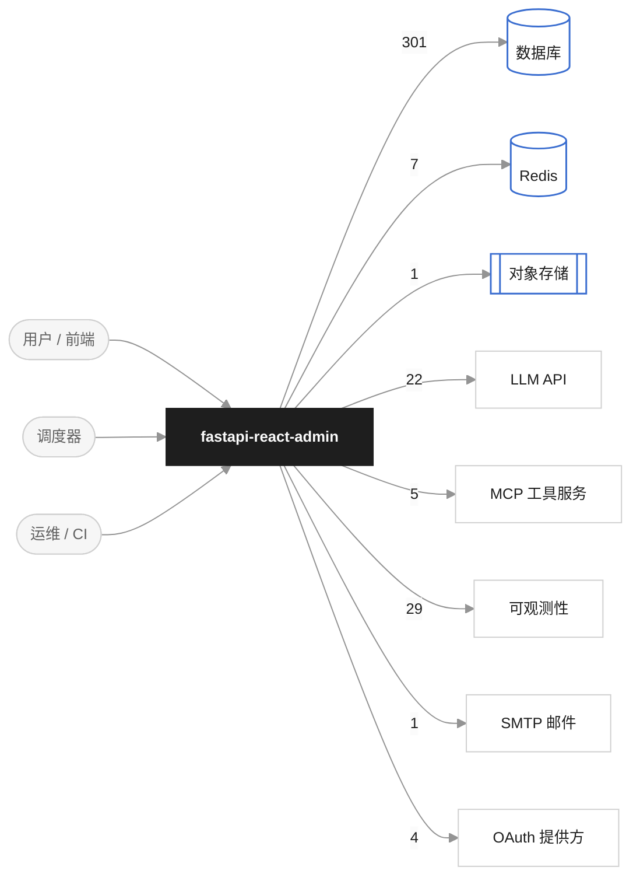
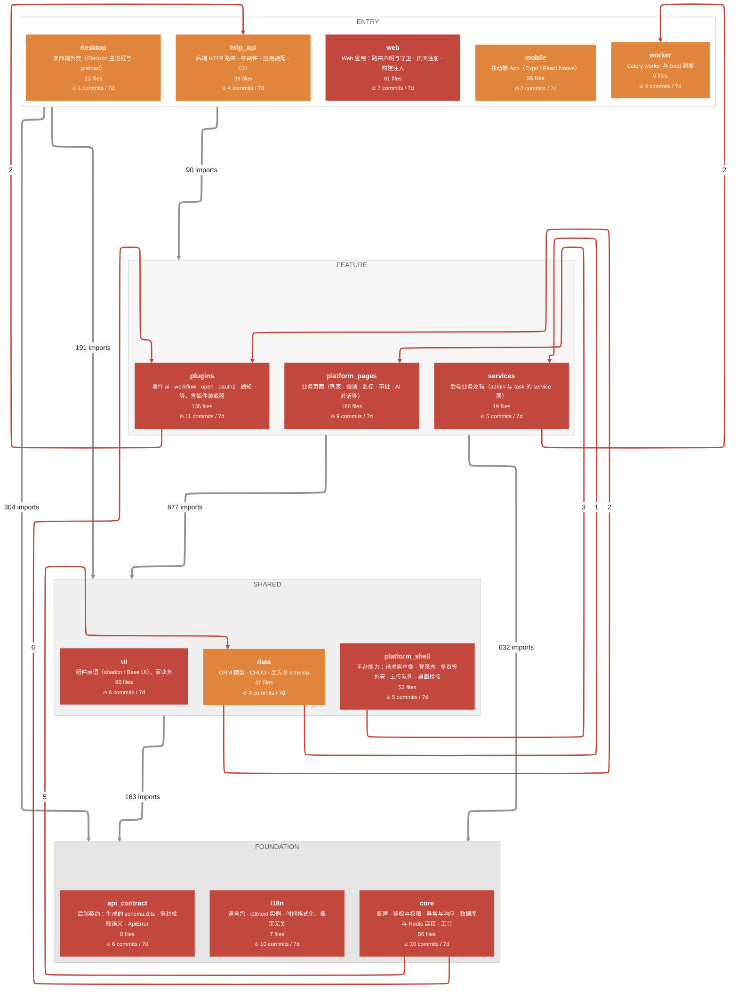
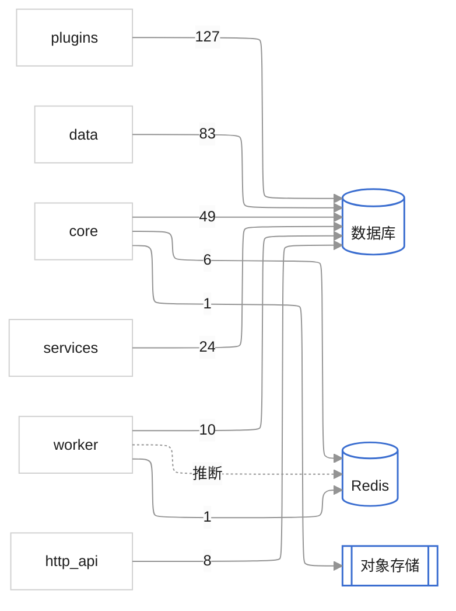
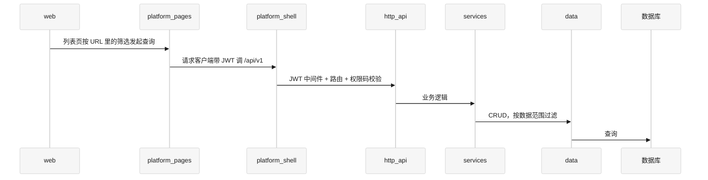
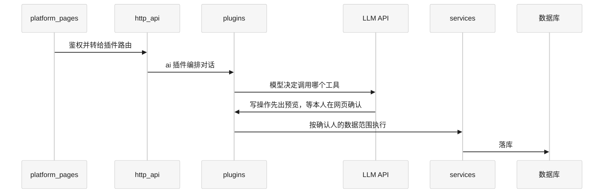
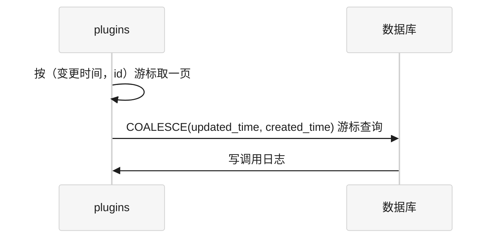

# fastapi-react-admin 架构图

> 生成时间 2026-10-22T15:15:11+08:00 · commit `d760795` · 范围 `全仓库` · 热度窗口锚点 2026-10-22 · 布局 elk
> 实线 = 静态 import 确认；虚线 = 模型推断（见 `arch-map.yml` 的 `inferred_edges`）。
> 由 arch-map 生成，判断依据在 `arch-map.yml`，请勿手改本文件。本地预览：`.cache/arch-map.html`。

中后台底座 monorepo：后端是 FastAPI（fork 自 FBA，三层 api → service → crud + 插件机制， 支持 SQL Server / PostgreSQL / MySQL），前端是 pnpm workspace，依赖方向 i18n / api 契约 ← ui ← platform ← web 严格单向；移动端（Expo）与桌面端（Electron）是 web 的兄弟。 前后端之间走 HTTP（/api/v1）与 socket.io，静态 import 看不到，只在核心流程里体现。

## 1. 发现

| 类型 | 边 / 对象 | 说明 | 证据 |
|---|---|---|---|
| layer_violation | `core->plugins` | foundation -> feature (向上 2 层, 6 处) | `apps/api/backend/common/security/rbac.py:79`, `apps/api/backend/core/conf.py:15`, `apps/api/backend/utils/dynamic_config.py:7` |
| layer_violation | `core->data` | foundation -> shared (向上 1 层, 5 处) | `apps/api/backend/common/security/jwt.py:15`, `apps/api/backend/common/security/jwt.py:16`, `apps/api/backend/common/security/jwt.py:247` |
| layer_violation | `platform_shell->platform_pages` | shared -> feature (向上 1 层, 3 处) | `packages/platform/src/shell/upload-store.ts:4`, `packages/platform/src/shell/upload-tray.tsx:8`, `packages/platform/src/shell/use-sidebar.ts:11` |
| layer_violation | `data->plugins` | shared -> feature (向上 1 层, 2 处) | `apps/api/backend/app/admin/crud/crud_user.py:33`, `apps/api/backend/app/admin/crud/crud_user.py:471` |
| layer_violation | `plugins->http_api` | feature -> entry (向上 1 层, 2 处) | `apps/api/backend/plugin/open/gateway/route.py:27`, `apps/api/backend/plugin/router.py:114` |
| layer_violation | `services->worker` | feature -> entry (向上 1 层, 2 处) | `apps/api/backend/app/task/service/scheduler_service.py:57`, `apps/api/backend/app/task/service/scheduler_service.py:115` |
| layer_violation | `data->services` | shared -> feature (向上 1 层, 1 处) | `apps/api/backend/app/admin/crud/crud_user.py:28` |

### 架构漂移

_首次生成，无历史快照。_

## 2. 系统上下文

## 3. 模块、分层与热度

层间粗箭头 = 向下依赖的 import 总数；红线 = 层违规（逐条）；虚线 = 推断。红块 = 近 7 天 ≥5 次提交，橙块 ≥1。模块间完整边表见附录。

| 模块 | 层 | 职责 | 文件 | 路径 |
|---|---|---|---|---|
| `http_api` | entry | 后端 HTTP 路由 · 中间件 · 应用装配 · CLI | 36 | `apps/api/backend/app/*/api/**, apps/api/backend/app/router.py, apps/api/backend/middleware/**, apps/api/backend/core/registrar.py, apps/api/backend/main.py, apps/api/backend/run.py, apps/api/backend/cli.py` |
| `data` | shared | ORM 模型 · CRUD · 出入参 schema | 47 | `apps/api/backend/app/*/crud/**, apps/api/backend/app/*/model/**, apps/api/backend/app/*/schema/**, apps/api/backend/app/task/enums.py` |
| `services` | feature | 后端业务逻辑（admin 与 task 的 service 层） | 19 | `apps/api/backend/app/*/service/**, apps/api/backend/app/admin/utils/**, apps/api/backend/app/__init__.py, apps/api/backend/app/admin/__init__.py` |
| `plugins` | feature | 插件 ai · workflow · open · oauth2 · 通知等，含插件装载器 | 135 | `apps/api/backend/plugin/**` |
| `worker` | entry | Celery worker 与 beat 调度 | 9 | `apps/api/backend/app/task/celery.py, apps/api/backend/app/task/tasks/**, apps/api/backend/app/task/*.py` |
| `core` | foundation | 配置 · 鉴权与权限 · 异常与响应 · 数据库与 Redis 连接 · 工具 | 56 | `apps/api/backend/common/**, apps/api/backend/core/**, apps/api/backend/database/**, apps/api/backend/utils/**, apps/api/backend/__init__.py` |
| `web` | entry | Web 应用：路由声明与守卫 · 页面注册 · 构建注入 | 61 | `apps/web/**` |
| `mobile` | entry | 移动端 App（Expo / React Native） | 55 | `apps/mobile/**` |
| `desktop` | entry | 桌面端外壳（Electron 主进程与 preload） | 13 | `apps/desktop/**` |
| `platform_pages` | feature | 业务页面（列表 · 设置 · 监控 · 审批 · AI 对话等） | 186 | `packages/platform/src/pages/**` |
| `platform_shell` | shared | 平台能力：请求客户端 · 登录态 · 多页签外壳 · 上传队列 · 桌面桥接 | 53 | `packages/platform/**` |
| `ui` | shared | 组件原语（shadcn / Base UI），零业务 | 80 | `packages/ui/**` |
| `api_contract` | foundation | 后端契约：生成的 schema.d.ts · 信封成败语义 · ApiError | 8 | `packages/api/**` |
| `i18n` | foundation | 语言包 · i18next 实例 · 时间格式化，框架无关 | 7 | `packages/i18n/**` |

## 4. 数据归属（谁在碰哪个存储）

## 5. 核心流程

### 用户打开一个列表页

### AI 助手调用写操作工具

### 外部系统增量同步（开放接口）

## 6. 变更热度（近 7 天 vs 前 7 天）

| 模块 | 近 7 天 | 前 7 天 | 趋势 | 近 30 天 |
|---|---|---|---|---|
| plugins | 11 | 0 | +11 | 11 |
| core | 10 | 0 | +10 | 10 |
| i18n | 10 | 0 | +10 | 10 |
| platform_pages | 9 | 0 | +9 | 9 |
| web | 7 | 0 | +7 | 7 |
| api_contract | 6 | 0 | +6 | 6 |
| ui | 6 | 0 | +6 | 6 |
| platform_shell | 5 | 0 | +5 | 5 |
| services | 5 | 0 | +5 | 5 |
| data | 4 | 0 | +4 | 4 |
| http_api | 4 | 0 | +4 | 4 |
| worker | 4 | 0 | +4 | 4 |
| mobile | 2 | 0 | +2 | 2 |
| desktop | 1 | 0 | +1 | 1 |

## 附录 A · 模块间依赖全表

| 从 | 到 | 类型 | 处数 | 证据 |
|---|---|---|---|---|
| `platform_pages` | `ui` | import | 573 | `packages/platform/src/pages/_shared/clear-logs.tsx:6` |
| `plugins` | `core` | import | 438 | `apps/api/backend/plugin/ai/api/router.py:3` |
| `http_api` | `core` | import | 256 | `apps/api/backend/app/admin/api/router.py:7` |
| `platform_pages` | `platform_shell` | import | 182 | `packages/platform/src/pages/_shared/clear-logs.tsx:9` |
| `data` | `core` | import | 150 | `apps/api/backend/app/admin/crud/crud_data_rule.py:8` |
| `services` | `core` | import | 142 | `apps/api/backend/app/admin/service/auth_service.py:15` |
| `services` | `data` | import | 93 | `apps/api/backend/app/admin/service/auth_service.py:7` |
| `http_api` | `data` | import | 87 | `apps/api/backend/app/admin/api/uploads.py:26` |
| `web` | `platform_shell` | import | 61 | `apps/web/src/app.tsx:5` |
| `platform_pages` | `i18n` | import | 52 | `packages/platform/src/pages/_shared/login-log.ts:1` |
| `web` | `platform_pages` | import | 38 | `apps/web/src/lib/page-registry.tsx:2` |
| `plugins` | `data` | import | 29 | `apps/api/backend/plugin/ai/mcp_gateway/auth.py:98` |
| `worker` | `core` | import | 26 | `apps/api/backend/app/task/celery.py:25` |
| `http_api` | `plugins` | import | 25 | `apps/api/backend/cli.py:50` |
| `platform_shell` | `ui` | import | 24 | `packages/platform/src/shell/app-sidebar.tsx:8` |
| `web` | `ui` | import | 22 | `apps/web/src/app.tsx:9` |
| `http_api` | `services` | import | 19 | `apps/api/backend/app/admin/api/uploads.py:27` |
| `desktop` | `platform_shell` | import | 12 | `apps/desktop/src/main/auth.ts:5` |
| `mobile` | `api_contract` | import | 9 | `apps/mobile/src/app/(app)/users/[id].tsx:7` |
| `platform_shell` | `i18n` | import | 9 | `packages/platform/src/auth/guards.ts:3` |
| `worker` | `data` | import | 9 | `apps/api/backend/app/task/database.py:9` |
| `plugins` | `services` | import | 8 | `apps/api/backend/plugin/ai/tools/dept_tools.py:11` |
| `mobile` | `i18n` | import | 7 | `apps/mobile/src/app/(app)/settings.tsx:9` |
| `core` | `plugins` | import | 6 | `apps/api/backend/common/security/rbac.py:79` |
| `services` | `plugins` | import | 6 | `apps/api/backend/app/admin/service/plugin_service.py:17` |
| `web` | `i18n` | import | 6 | `apps/web/src/app.tsx:4` |
| `core` | `data` | import | 5 | `apps/api/backend/common/security/jwt.py:15` |
| `platform_shell` | `api_contract` | import | 4 | `packages/platform/src/api-client/client.ts:1` |
| `worker` | `plugins` | import | 4 | `apps/api/backend/app/task/tasks/maintenance/tasks.py:85` |
| `worker` | `services` | import | 4 | `apps/api/backend/app/task/tasks/maintenance/tasks.py:145` |
| `platform_shell` | `platform_pages` | import | 3 | `packages/platform/src/shell/upload-store.ts:4` |
| `data` | `plugins` | import | 2 | `apps/api/backend/app/admin/crud/crud_user.py:33` |
| `plugins` | `http_api` | import | 2 | `apps/api/backend/plugin/open/gateway/route.py:27` |
| `services` | `worker` | import | 2 | `apps/api/backend/app/task/service/scheduler_service.py:57` |
| `data` | `services` | import | 1 | `apps/api/backend/app/admin/crud/crud_user.py:28` |

## 附录 B · 未归属项

- 未归属文件：0
- 未映射到外部系统的第三方包：fastapi (241), react (215), @tabler/icons-react (149), react-i18next (142), @tanstack/react-query (112), pydantic (91), @tanstack/react-router (58), starlette (57), zod (46), react-native (31), @base-ui/react (31), @tanstack/react-table (30), pyrate_limiter (20), celery (18), lucide-react-native (16)

> 第三方框架（fastapi、pydantic、langchain_core…）属于代码本身而非外部系统，无需映射。
